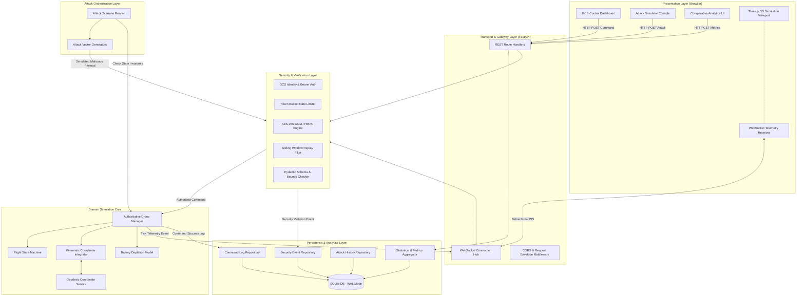
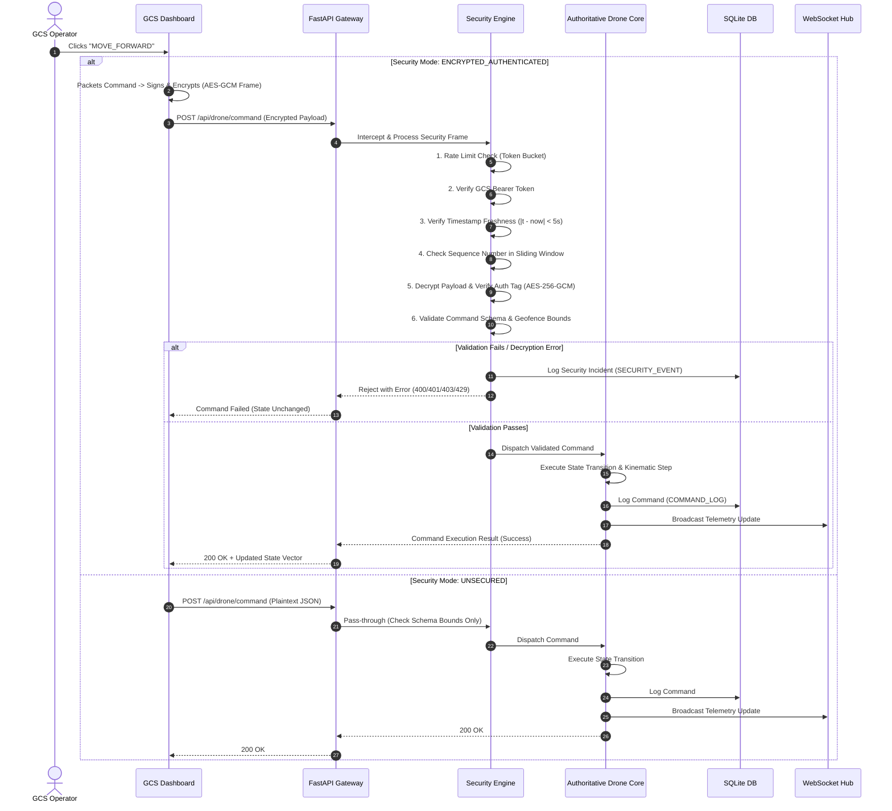
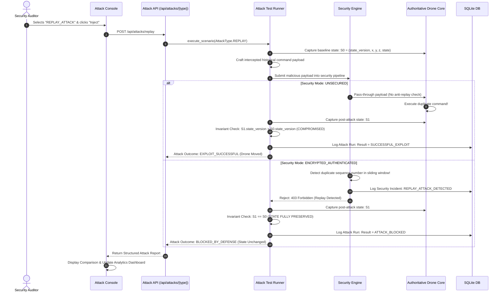
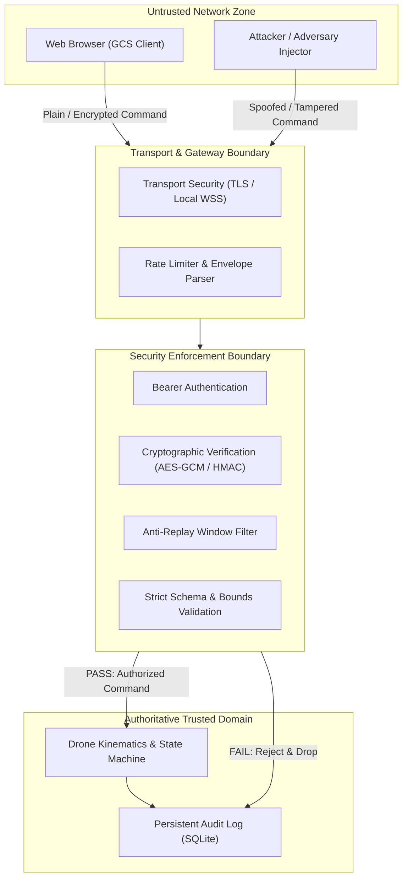
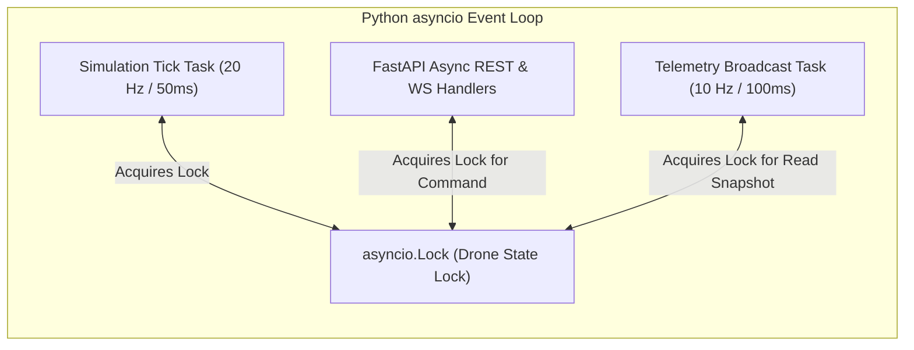

# System Architecture Blueprint
## Drone Communication Security Simulation Platform (Phase 0)

---

### Document Information
- **Project:** Drone Communication Security Simulation Platform
- **Phase:** Phase 0 — Requirements and Architecture Blueprint
- **Version:** 1.0.0
- **Status:** APPROVED FOR ARCHITECTURE
- **Classification:** Architectural Blueprint & Component Specifications

---

## 1. Architectural Principles & Overview

The **Drone Communication Security Simulation Platform** is built upon five foundational architectural tenets:

1. **Authoritative Backend Simulation:** The backend server is the single source of ground truth for all drone flight kinematics, battery states, geofence validations, and state machines. The frontend is strictly a downstream renderer and command emitter.
2. **Decoupled Security Pipeline:** The cryptographic and security verification engine is modular, independently testable, and strictly decoupled from web framework routing logic. It acts as an intercepting gateway before any instruction can reach the simulation core.
3. **Fail-Closed Defensive Boundary:** Any security failure (bad signature, failed decryption, expired timestamp, replay detection, or out-of-bounds parameter) immediately aborts processing, triggers an immutable security audit event, and guarantees zero mutation of authoritative drone state.
4. **Deterministic & Observable Simulation Loop:** The kinematic engine runs on a periodic tick interval ($20\text{ Hz}$ / $50\text{ ms}$) with deterministic state updates, while telemetry broadcasts to subscribed clients at a tuned cadence ($10\text{ Hz}$ / $100\text{ ms}$).
5. **Zero Cloud Dependencies:** The entire architecture operates strictly on local loopback (`localhost`), utilizing SQLite for persistence and native browser WebGL/Three.js for graphics.

---

## 2. Layered Component Architecture



---

## 3. Data Flow Architectures

### 3.1 Normal Command Execution Flow (Secured vs. Unsecured)



### 3.2 Authoritative Simulation & Telemetry Broadcast Flow

```mermaid
sequenceDiagram
    autonumber
    participant Loop as Background Simulation Task (20 Hz)
    participant Drone as Authoritative Drone State
    participant Geo as Geodesic Service
    participant WS as WebSocket Hub
    participant Client as Frontend GCS / Three.js

    loop Every 50 ms (20 Hz)
        Loop->>Drone: tick(dt = 0.05s)
        Drone->>Drone: Update active kinematic positions (x, y, z)
        Drone->>Drone: Update heading & linear speed
        Drone->>Drone: Deplete battery based on flight state
        Drone->>Drone: Check low-battery & geofence safety triggers
        Drone->>Geo: Convert (x, y, z) -> (lat, lon, alt_msl)
        Geo-->>Drone: Return geographic coordinates
        Drone->>Drone: Increment state_version counter
    end

    loop Every 100 ms (10 Hz Telemetry Cadence)
        Loop->>Drone: get_telemetry_snapshot()
        Drone-->>WS: Authoritative Telemetry Vector
        WS->>Client: Broadcast WS frame (JSON / binary)
        Client->>Client: Update Three.js Drone Mesh Position & Rotation
        Client->>Client: Update HUD Gauges & Coordinate Readouts
    end
```

### 3.3 Attack Simulator Execution & Invariant Evaluation Flow



---

## 4. Component Responsibilities & State Ownership

To maintain strict modularity and eliminate cross-contamination between components, state ownership is assigned as follows:

| Component | Responsibility | Owned State | State Access Rules |
|---|---|---|---|
| **Drone Simulation Core** (`DroneEngine`) | Manages authoritative physical state, kinematic integration, flight states, battery life, and geofence boundary enforcement. | `state_version`, `flight_state`, `x, y, z`, `heading`, `speed`, `battery_level`, `armed`. | Read: Public via snapshot. Write: Strictly internal via validated commands or periodic tick. |
| **Coordinate Service** (`GeoCoordinateService`) | Performs geodesic flat-earth conversions between local Cartesian coordinates $(x, y, z)$ and WGS-84 $(\text{lat}, \text{lon}, \text{alt})$. | `origin_lat`, `origin_lon`, `origin_alt`. | Immutable configuration loaded at startup. Pure mathematical transformations without side-effects. |
| **Security Engine** (`SecurityPipeline`) | Authenticates GCS, verifies rate limits, decrypts AEAD frames, checks replay sliding window, and validates command bounds. | Active Security Mode, Sliding Window Bitmask, Last Sequence Number, Token Bucket Counters. | Mutable security state. Has NO direct write access to drone kinematic state. |
| **WebSocket Hub** (`TelemetryHub`) | Maintains active client connections, manages ping/pong keepalives, and serializes/broadcasts telemetry frames. | Connected client WebSockets, client subscription states. | Ephemeral network state. Consumes read-only drone state snapshots. |
| **Attack Harness** (`AttackScenarioRunner`) | Houses reproducible attack vectors, crafts hostile frames, tests security defenses, and asserts state invariants. | Pre-configured attack payloads, current attack run status. | Transmits to security pipeline. Never directly writes to drone state. |
| **Persistence Repositories** (`DatabaseRepository`) | Manages SQLite connection pooling, executes transactional writes, and queries audit trails. | SQLite database files, prepared statements. | Append-only audit logs. Read-only queries for analytics. |
| **Analytics Engine** (`AnalyticsService`) | Computes real-time comparative metrics ($ARR$, $SAR$, $LCSR$, latency percentiles) using SQL aggregations. | In-memory metrics cache with periodic invalidation. | Derives values dynamically from the SQLite audit logs. |
| **Frontend GCS** (Browser Three.js / JS) | Renders 3D graphics, displays HUD telemetry, and captures pilot input. | Viewport camera state, local UI preferences, input button states. | Downstream consumer. No authoritative state ownership. |

---

## 5. Trust Boundaries & Security Enclaves



### 5.1 Trust Boundary Rules
1. **The Browser is Untrusted:** The backend assumes all data received over HTTP or WebSockets may be forged, manipulated, or replayed. Client-side state assertions are completely ignored.
2. **Cryptographic Secrets Isolation:** Symmetric encryption keys (`AES-256`) and signing keys (`HMAC-SHA-256`) reside solely in backend memory or secure environment variables. Keys are **never transmitted** to the frontend client. (In a real GCS, keys would reside in a secure GCS element; in this simulation, the backend's attack runner and client simulator simulate GCS cryptographic packaging server-side or via an isolated GCS helper service).
3. **Security Mode `UNSECURED` Isolation:** When the platform runs in `UNSECURED` mode for educational demonstration, the security pipeline logs a warning and permits plaintext execution. However, **physical safety invariants** (e.g. bounding box clamping, memory safety, Pydantic type safety) remain active to prevent server crashes.

---

## 6. Concurrency, Threading, and Execution Model

To ensure deterministic simulation without race conditions, the system uses an asynchronous architecture built on Python's `asyncio` event loop:



### 6.1 State Concurrency Guarantees
- **Atomic State Transitions:** All read-modify-write operations on the drone's authoritative state vector are guarded by an `asyncio.Lock` (`state_lock`).
- **Tick Predictability:** The simulation tick runs in a dedicated background task using high-precision monotonic timing (`asyncio.sleep` with loop drift compensation).
- **Non-Blocking I/O:** Database writes (command logs, security events) execute asynchronously or via a lightweight background queue so that disk I/O does not delay the $20\text{ Hz}$ kinematic loop.

---

## 7. Modular Project Directory Structure

```
drone-security-platform/
│
├── docs/                               # Phase 0 Architectural Documentation
│   ├── requirements.md                 # System requirements specification
│   ├── architecture.md                 # System architecture blueprint (this document)
│   ├── api-contract.md                 # OpenAPI and WebSocket contract specification
│   ├── coordinate-system.md            # Coordinate frames, geodesic math & Three.js mapping
│   ├── security-design.md              # Cryptographic protocols & threat model
│   ├── attack-test-plan.md             # Attack scenarios & invariant verification
│   ├── testing-strategy.md             # Multi-tier testing suite specification
│   └── development-roadmap.md          # 10-phase roadmap with milestones
│
├── backend/                            # Authoritative Python Backend Application
│   ├── app/
│   │   ├── __init__.py
│   │   ├── main.py                     # FastAPI application entrypoint & lifespan
│   │   ├── config.py                   # Environment settings & Pydantic BaseSettings
│   │   │
│   │   ├── api/                        # Transport & Route Handlers
│   │   │   ├── __init__.py
│   │   │   ├── deps.py                 # Dependency injection (Auth, DB, Services)
│   │   │   ├── routes_drone.py         # /api/drone/* (state, command, telemetry)
│   │   │   ├── routes_security.py      # /api/security/* (status, mode toggle)
│   │   │   ├── routes_attacks.py       # /api/attacks/* (injection trigger, history)
│   │   │   ├── routes_analytics.py     # /api/analytics/* (metrics, summaries)
│   │   │   └── websocket_hub.py        # /ws/telemetry connection manager
│   │   │
│   │   ├── core/                       # Core Simulation Logic (No Framework Dependencies)
│   │   │   ├── __init__.py
│   │   │   ├── drone_engine.py         # Authoritative Drone Simulator & Kinematics
│   │   │   ├── flight_fsm.py           # Finite State Machine & Valid Transitions
│   │   │   ├── coordinate_service.py   # Local XYZ <-> Geodesic WGS-84 Flat-Earth Math
│   │   │   └── battery_model.py        # Battery depletion & emergency descent rules
│   │   │
│   │   ├── security/                   # Modular Security & Cryptographic Engine
│   │   │   ├── __init__.py
│   │   │   ├── crypto_engine.py        # AES-256-GCM AEAD & HMAC-SHA-256 implementations
│   │   │   ├── anti_replay.py          # Sliding-window sequence filter & timestamp checks
│   │   │   ├── rate_limiter.py         # Token-bucket rate limiting implementation
│   │   │   ├── key_manager.py          # Key generation, loading & ephemeral secrets
│   │   │   └── security_pipeline.py    # Interceptor pipeline coordinating security checks
│   │   │
│   │   ├── attacks/                    # Attack Test Scenarios & Invariant Checkers
│   │   │   ├── __init__.py
│   │   │   ├── attack_runner.py        # Scenario executor & invariant evaluator
│   │   │   ├── payload_factory.py      # Malicious frame crafting (tamper, replay, flood)
│   │   │   └── attack_types.py         # Attack type enumerations & data models
│   │   │
│   │   ├── db/                         # Persistence & Repositories
│   │   │   ├── __init__.py
│   │   │   ├── database.py             # SQLite connection setup, WAL mode & migrations
│   │   │   ├── models.py               # Database table schemas
│   │   │   └── repositories.py         # CRUD operations for commands, events & metrics
│   │   │
│   │   ├── analytics/                  # Statistical Aggregation
│   │   │   ├── __init__.py
│   │   │   └── metrics_service.py      # Derived security metrics (ARR, SAR, Latency)
│   │   │
│   │   └── schemas/                    # Pydantic Request & Response Data Models
│   │       ├── __init__.py
│   │       ├── drone_schemas.py        # State, command & telemetry schemas
│   │       ├── security_schemas.py     # Crypto envelopes, security status schemas
│   │       ├── attack_schemas.py       # Attack trigger & result schemas
│   │       └── analytics_schemas.py    # Analytics report schemas
│   │
│   └── tests/                          # Automated Pytest Suite
│       ├── conftest.py                 # Fixtures & mock setups
│       ├── test_drone_engine.py        # Unit tests for kinematics & state machine
│       ├── test_coordinates.py         # Unit tests for geodesic math
│       ├── test_security_crypto.py     # Unit tests for AES-GCM, HMAC & Anti-Replay
│       ├── test_rate_limiter.py        # Unit tests for token bucket rate limiting
│       ├── test_api_routes.py          # FastAPI TestClient integration tests
│       ├── test_websockets.py          # Asynchronous WebSocket streaming tests
│       ├── test_attack_scenarios.py    # Negative security tests for all 6 vectors
│       └── test_state_invariants.py    # Verification that rejected commands don't alter state
│
├── frontend/                           # Lightweight Web-Based Ground Control Station
│   ├── index.html                      # Single-page GCS application entrypoint
│   ├── css/
│   │   ├── main.css                    # Modern tactical dark-mode dashboard styling
│   │   ├── hud.css                     # Telemetry gauges, compass & flight controls
│   │   └── panels.css                  # Attack console, security status & logs styling
│   └── js/
│       ├── app.js                      # Application bootstrap & event bus
│       ├── api_client.js               # REST client for commands, attacks & analytics
│       ├── ws_client.js                # WebSocket telemetry client with auto-reconnect
│       ├── three_viewport.js           # Three.js scene setup, lighting & rendering loop
│       ├── world_builder.js            # Procedural ground, helipad, buildings & runway
│       ├── drone_mesh.js               # Procedural 3D drone model & propeller animations
│       ├── trajectory_trail.js         # Dynamic flight path ribbon visualization
│       ├── flight_controls.js          # Interactive pilot keyboard & button bindings
│       ├── security_panel.js           # Security mode toggling & key status
│       ├── attack_panel.js             # Attack injection UI & outcome alerts
│       └── analytics_view.js           # Live comparative charts & rejection metrics
│
├── data/                               # Local persistent storage (gitignored)
│   └── simulation.db                   # SQLite database file (WAL mode)
│
├── requirements.txt                    # Python runtime & test dependencies
├── README.md                           # Quickstart, installation & execution guide
└── .gitignore                          # Standard Python/IDE ignore rules
```

---

## 8. Module Dependency Rules

To prevent spaghetti architecture and circular dependencies:
1. `core` (Drone kinematics, state machine) must **never import** from `api`, `security`, `attacks`, or `db`. It is completely standalone.
2. `security` must **never import** from `api` or `core.drone_engine`. It receives raw payloads and returns validated payloads or raises specific security exceptions.
3. `attacks` depends on `security` and `core` only to craft payloads and evaluate state invariants.
4. `api` acts as the orchestrator, binding incoming requests to `security`, dispatching to `core`, logging to `db`, and formatting responses.
