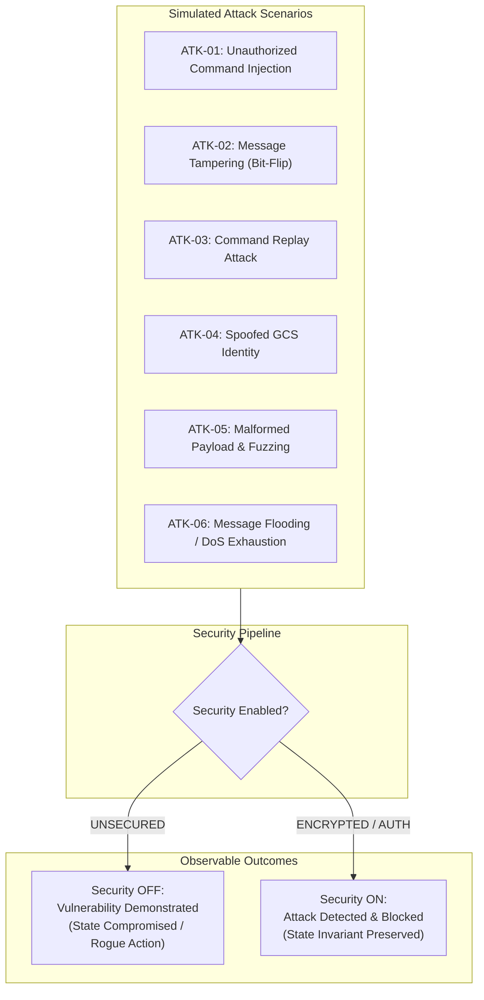
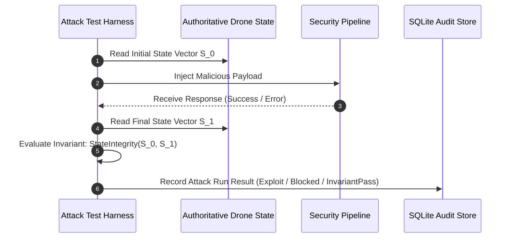

# Cyberattack Simulation & Security Test Plan
## Drone Communication Security Simulation Platform (Phase 0)

---

### Document Information
- **Project:** Drone Communication Security Simulation Platform
- **Phase:** Phase 0 — Requirements and Architecture Blueprint
- **Version:** 1.0.0
- **Status:** APPROVED FOR ARCHITECTURE
- **Classification:** Controlled Vulnerability & Attack Verification Plan

---

## 1. Safety Principles & Execution Scope

All cyberattack simulations detailed in this plan are strictly confined to the local software-in-the-loop simulation environment. 
- **Local Isolation:** All test packets originate from and terminate at the local host (`localhost:8000`).
- **No External Targets:** No tests shall target external networks, software-defined radios (SDRs), or physical UAV hardware.
- **RF Jamming Exclusion:** Physical layer radio frequency interference and signal jamming are strictly outside the scope of this platform.
- **Deterministic Evaluation:** Each test scenario evaluates the behavior under both `UNSECURED` mode and `ENCRYPTED_AUTHENTICATED` (or `INTEGRITY_ONLY`) mode to provide rigorous empirical comparative data.
- **Baseline Realism:** Even in `UNSECURED` mode, the baseline system is not assumed to accept syntactically corrupted or out-of-bounds data; baseline failures are explicitly documented where input validation handles them.

---

## 2. Attack Scenarios Catalog

---

### Scenario ATK-01: Unauthorized Command Injection

- **Objective:** Demonstrate that an unauthenticated third-party actor can inject flight commands into an unsecured drone link, whereas authenticated channels reject the injection.
- **Preconditions:**
  - Drone is airborne in `HOVERING` state at $(x, y, z) = (0.0, 5.0, 0.0)\text{ m}$.
  - Initial `state_version` $= N_0$.
- **Attacker Input / Payload:**
  - Injected command: `DISARM` or `MOVE_FORWARD` (distance $5.0\text{ m}$).
  - Credentials: None (omitted HTTP Authorization header and omitted cryptographic token).
- **Behavior with Security Disabled (`UNSECURED`):**
  - **Outcome:** Command is processed.
  - **Drone Action:** Drone accepts command, disarms in mid-air (triggering emergency fall/landing) or displaces to $z = 5.0\text{ m}$.
  - **Exploit Status:** `SUCCESSFUL_EXPLOIT` (Unauthorized state change).
- **Behavior with Security Enabled (`ENCRYPTED_AUTHENTICATED`):**
  - **Outcome:** HTTP `401 Unauthorized` / `403 Forbidden`.
  - **Defense Mechanism:** Bearer authentication gate rejects request before any domain processing occurs.
  - **Drone Action:** Drone remains in `HOVERING` at $(0.0, 5.0, 0.0)\text{ m}$.
  - **Exploit Status:** `ATTACK_BLOCKED`.
- **State Invariant Assertions:**
  - $\text{state\_version}_{\text{final}} == N_0$
  - $\Delta(x, y, z) == (0.0, 0.0, 0.0)$
  - `flight_state == HOVERING`
- **Logged Events:**
  - `SECURITY_EVENT`: `AUTH_TOKEN_MISSING`, Severity: `HIGH`, Source: `ATTACK_SIMULATOR`.
- **Recorded Metrics:** Rejection latency ($t_{\text{proc}}$), attack rejection counter incremented.

---

### Scenario ATK-02: Message Tampering (Integrity Violation / Bit-Flipping)

- **Objective:** Demonstrate an adversary intercepting a valid command in transit and altering its payload parameters.
- **Preconditions:**
  - Drone is hovering at $(0.0, 5.0, 0.0)\text{ m}$.
  - GCS emits a valid command to move right by $2.0\text{ m}$ (`MOVE_RIGHT`, $x = +2.0$).
- **Attacker Input / Payload:**
  - Attacker intercepts the frame and alters payload to `MOVE_LEFT` ($x = -2.0$) or alters an encrypted ciphertext byte / tag.
- **Behavior with Security Disabled (`UNSECURED`):**
  - **Outcome:** Modified payload is parsed as valid JSON.
  - **Drone Action:** Drone moves in the tampered direction ($-X$ instead of $+X$).
  - **Exploit Status:** `SUCCESSFUL_EXPLOIT` (Targeted path deviation).
- **Behavior with Security Enabled (`INTEGRITY_ONLY` / `ENCRYPTED_AUTHENTICATED`):**
  - **Outcome:** HTTP `403 Forbidden`.
  - **Defense Mechanism:** 
    - In `INTEGRITY_ONLY`: HMAC-SHA-256 verification fails.
    - In `ENCRYPTED_AUTHENTICATED`: AES-256-GCM authentication tag verification fails mathematically.
  - **Drone Action:** Frame discarded with zero execution. Drone position unchanged.
  - **Exploit Status:** `ATTACK_BLOCKED`.
- **State Invariant Assertions:**
  - $\Delta(x, y, z) == (0.0, 0.0, 0.0)$
  - `flight_state` remains `HOVERING`.
- **Logged Events:**
  - `SECURITY_EVENT`: `CRYPTO_TAG_MISMATCH` or `HMAC_VERIFICATION_FAILED`, Severity: `CRITICAL`.
- **Recorded Metrics:** Rejection latency, integrity error counter.

---

### Scenario ATK-03: Command Replay Attack

- **Objective:** Demonstrate an adversary sniffing a legitimate past command frame and replaying it at a later time.
- **Preconditions:**
  - GCS previously emitted a valid `MOVE_FORWARD` command with `sequence_number` $= 102$ at $t_0$.
  - Drone executed it and advanced to $z = 2.0\text{ m}$.
  - Simulation time is now $t_1 = t_0 + 10.0\text{ s}$, current sequence is $115$.
- **Attacker Input / Payload:**
  - Attacker re-submits exact bitstream of sequence $102$ frame.
- **Behavior with Security Disabled (`UNSECURED`):**
  - **Outcome:** The unsecured endpoint has no sequence cache; command executes again.
  - **Drone Action:** Drone moves forward another $2.0\text{ m}$ ($z = 4.0\text{ m}$).
  - **Exploit Status:** `SUCCESSFUL_EXPLOIT` (Unintended drone travel).
- **Behavior with Security Enabled (`ENCRYPTED_AUTHENTICATED`):**
  - **Outcome:** HTTP `403 Forbidden` (`REPLAY_ATTACK_DETECTED`).
  - **Defense Mechanism:**
    - Dual filter: Timestamp ($t_0$) fails freshness test ($|t_{\text{server}} - t_0| > 5.0\text{ s}$).
    - Sliding window checks sequence $102 < (115 - 64)$ and marks it stale.
  - **Drone Action:** Payload dropped. Drone position unchanged.
  - **Exploit Status:** `ATTACK_BLOCKED`.
- **State Invariant Assertions:**
  - Position remains at $z = 2.0\text{ m}$.
  - `state_version` does not increment.
- **Logged Events:**
  - `SECURITY_EVENT`: `REPLAY_ATTACK_DETECTED`, Details: `replayed_seq: 102, active_seq: 115`.
- **Recorded Metrics:** Anti-replay rejection latency, replay counter.

---

### Scenario ATK-04: Spoofed GCS Identity

- **Objective:** Demonstrate an adversary crafting a command claiming to be the authoritative operator using a counterfeit identifier or invalid cryptographic signature.
- **Preconditions:**
  - Drone is in flight.
- **Attacker Input / Payload:**
  - Request with header `sender_id: GCS_PRIMARY` signed using a fake or mismatched key.
- **Behavior with Security Disabled (`UNSECURED`):**
  - **Outcome:** Endpoint reads `sender_id` string without verification; executes command.
  - **Exploit Status:** `SUCCESSFUL_EXPLOIT`.
- **Behavior with Security Enabled (`ENCRYPTED_AUTHENTICATED`):**
  - **Outcome:** HTTP `403 Forbidden` (Decryption/Signature failure).
  - **Defense Mechanism:** Key derivation and AEAD tag calculation require shared secret.
  - **Exploit Status:** `ATTACK_BLOCKED`.
- **State Invariant Assertions:** Authoritative drone state is preserved.

---

### Scenario ATK-05: Malformed Payload & Fuzzing Injection

- **Objective:** Demonstrate the system's robustness against malformed data types, out-of-range coordinates, and unexpected command codes.
- **Preconditions:**
  - System operational.
- **Attacker Input / Payload:**
  - Coordinate overflow: $x = 1.0\times 10^9\text{ m}$.
  - Non-existent enum: `command: "DO_BARREL_ROLL"`.
  - Type corruption: `parameters: "not_a_json_dict"`.
- **Behavior with Security Disabled (`UNSECURED`):**
  - **Outcome:** HTTP `422 Unprocessable Entity` or `400 Bad Request`.
  - **Note on Baseline Realism:** Even with security disabled, standard Pydantic schema validation and geofence guards prevent crashes and ignore invalid commands. The drone **does not** crash or execute invalid movements.
  - **Exploit Status:** `BASELINE_REJECTED` (Safely handled by input sanitizer).
- **Behavior with Security Enabled (`ENCRYPTED_AUTHENTICATED`):**
  - **Outcome:** Rejected at cryptographic or schema validation stage.
  - **Exploit Status:** `ATTACK_BLOCKED`.
- **State Invariant Assertions:** No server crash, zero state mutation.

---

### Scenario ATK-06: Message Flooding / Rate-Limit Exhaustion

- **Objective:** Demonstrate protection against denial-of-service command bursts designed to saturate processing pipelines.
- **Preconditions:**
  - System healthy.
- **Attacker Input / Payload:**
  - Burst transmission: 100 HTTP requests in $300\text{ ms}$ ($> 300\text{ req/s}$).
- **Behavior with Security Disabled (`UNSECURED`):**
  - **Outcome:** Requests queued and processed up to server worker capacity, causing high processing latency ($> 200\text{ ms}$).
  - **Exploit Status:** `RESOURCE_SATURATION`.
- **Behavior with Security Enabled (`ENCRYPTED_AUTHENTICATED`):**
  - **Outcome:** First 20 requests consumed (burst capacity); remaining 80 requests receive immediate HTTP `429 Too Many Requests`.
  - **Defense Mechanism:** Token-bucket rate limiter rejects before cryptographic evaluation, conserving CPU.
  - **Exploit Status:** `ATTACK_MITIGATED`.
- **State Invariant Assertions:** Drone loop maintain stable $20\text{ Hz}$ tick rate without jitter.

---

## 3. Attack Run Execution & Invariant Evaluation Protocol

### Invariant Verification Formula
For any attack $A \in \{\text{ATK-01} \dots \text{ATK-06}\}$ under security defense:
$$\mathcal{I}(S_0, S_1) = \begin{cases} 
\text{True (Pass)}, & \text{if } S_1.\text{state\_version} = S_0.\text{state\_version} \;\land\; \|S_1.\mathbf{p} - S_0.\mathbf{p}\| = 0 \\
\text{False (Compromised)}, & \text{otherwise}
\end{cases}$$
