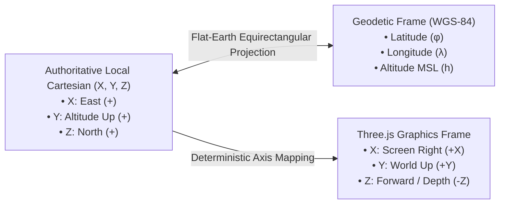
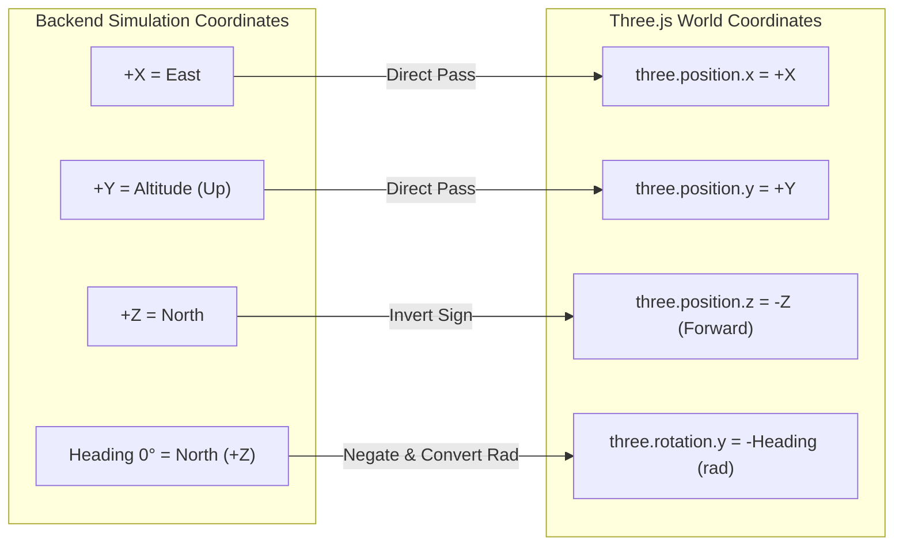

# Coordinate System & Spatial Transformation Specification
## Drone Communication Security Simulation Platform (Phase 0)

---

### Document Information
- **Project:** Drone Communication Security Simulation Platform
- **Phase:** Phase 0 — Requirements and Architecture Blueprint
- **Version:** 1.0.0
- **Status:** APPROVED FOR ARCHITECTURE
- **Classification:** Mathematics, Coordinate Frames & Transformation Reference

---

## 1. Coordinate Frame Definitions

The platform employs three distinct coordinate frames across its architecture:
1. **Local Cartesian Frame (Simulation Truth):** Right-handed Euclidean $(X, Y, Z)$ frame in metres, anchored at a local datum $(0, 0, 0)$.
2. **Geodetic World Frame (GPS / Geographic):** World Geodetic System 1984 (WGS-84) ellipsoidal coordinates: Latitude $(\phi)$, Longitude $(\lambda)$, and Altitude Above Mean Sea Level $(h_{\text{MSL}})$.
3. **Graphics Rendering Frame (Three.js WebGL):** Right-handed WebGL scene coordinate system used for client-side visual rendering.



---

## 2. Local Cartesian Frame (Authoritative Truth)

The authoritative simulation backend represents drone position and motion strictly in the Local Cartesian Frame:

### 2.1 Axis Conventions
- **X Axis (East-West):** Units in metres.
  - Positive $+X$: Eastward displacement.
  - Negative $-X$: Westward displacement.
- **Y Axis (Vertical Altitude):** Units in metres.
  - Positive $+Y$: Altitude upward above ground reference.
  - $Y = 0.0\text{ m}$: Top surface of the takeoff helipad.
  - Negative values ($Y < 0.0\text{ m}$): Physically impossible / subterranean; strictly prevented by ground collision bounds.
- **Z Axis (North-South):** Units in metres.
  - Positive $+Z$: Northward displacement.
  - Negative $-Z$: Southward displacement.

### 2.2 Heading & Rotation Convention
The drone heading angle ($\theta$) is defined using standard navigation and compass heading conventions:
- $\theta = 0^\circ$: True North ($+Z$ axis direction)
- $\theta = 90^\circ$: East ($+X$ axis direction)
- $\theta = 180^\circ$: South ($-Z$ axis direction)
- $\theta = 270^\circ$: West ($-X$ axis direction)
- Heading normalizes continuously within the interval $[0.0^\circ, 360.0^\circ)$.

### 2.3 Initial State & Helipad Anchor
- **Initial Drone Position:** $(x_0, y_0, z_0) = (0.0, 0.0, 0.0)\text{ m}$.
- **Initial Heading:** $\theta_0 = 0.0^\circ$ (Facing North).
- **Initial Velocity:** $(v_x, v_y, v_z) = (0.0, 0.0, 0.0)\text{ m/s}$.
- **Helipad Dimensions:** A square landing zone centered at $(0.0, 0.0, 0.0)$ with dimensions $10.0\text{ m} \times 10.0\text{ m}$.

---

## 3. Configurable Geographic Origin

The local origin $(0.0, 0.0, 0.0)$ is anchored to a configurable geographic datum. The origin parameters are managed centrally via application configuration (`config.py` or environment variables) and are **never hardcoded**:

| Configuration Key | Data Type | Default Value | Description |
|---|---|---|---|
| `SIM_ORIGIN_LATITUDE` | Float | `37.774929` | Reference origin latitude in decimal degrees (North positive). |
| `SIM_ORIGIN_LONGITUDE` | Float | `-122.419416` | Reference origin longitude in decimal degrees (East positive). |
| `SIM_ORIGIN_ALTITUDE_MSL`| Float | `15.0` | Reference ground elevation above Mean Sea Level in metres. |
| `SIM_GEOFENCE_RADIUS_M` | Float | `100.0` | Horizontal geofence limit from origin in metres. |
| `SIM_MAX_ALTITUDE_M` | Float | `50.0` | Maximum operational altitude ceiling in metres. |

---

## 4. Mathematical Geodesic Transformations

For small localized operational zones (operational radius $\le 5\text{ km}$), standard spherical flat-earth (Equirectangular) equations provide millimeter-level accuracy ($< 0.05\text{ mm}$ error relative to full Vincenty/Karney geodesic formulas) with near-zero computational overhead.

### 4.1 Constants
- Earth Mean Radius (WGS-84): $R = 6,378,137.0\text{ metres}$.
- Degrees to Radians: $\text{rad} = \text{deg} \times \frac{\pi}{180}$.
- Radians to Degrees: $\text{deg} = \text{rad} \times \frac{180}{\pi}$.

### 4.2 Forward Transformation: Local $(x, y, z) \to (\text{lat}, \text{lon}, \text{alt}_{\text{MSL}})$

Given local coordinates $(x, y, z)$ in metres and origin $(\phi_0, \lambda_0, h_0)$:

1. **Latitude Offset:**
   $$\Delta \phi = \frac{z}{R} \quad \text{(radians)}$$
   $$\text{latitude} (\phi) = \phi_0 + \Delta \phi \times \left(\frac{180}{\pi}\right)$$

2. **Longitude Offset:**
   $$\Delta \lambda = \frac{x}{R \cdot \cos\left(\phi_0 \times \frac{\pi}{180}\right)} \quad \text{(radians)}$$
   $$\text{longitude} (\lambda) = \lambda_0 + \Delta \lambda \times \left(\frac{180}{\pi}\right)$$

3. **Altitude Above Sea Level:**
   $$\text{altitude}_{\text{MSL}} = h_0 + y$$

### 4.3 Inverse Transformation: $(\text{lat}, \text{lon}, \text{alt}_{\text{MSL}}) \to \text{Local } (x, y, z)$

Given geodetic coordinates $(\phi, \lambda, h)$ and origin $(\phi_0, \lambda_0, h_0)$:

1. **Local North-South $(z)$:**
   $$z = (\phi - \phi_0) \times \left(\frac{\pi}{180}\right) \times R$$

2. **Local East-West $(x)$:**
   $$x = (\lambda - \lambda_0) \times \left(\frac{\pi}{180}\right) \times R \times \cos\left(\phi_0 \times \frac{\pi}{180}\right)$$

3. **Local Altitude $(y)$:**
   $$y = h - h_0$$

### 4.4 Round-Trip Numerical Consistency Guarantee
Unit tests require that for any point inside the simulation volume:
$$\left\| (x, y, z) - \text{Inverse}(\text{Forward}(x, y, z)) \right\| < 1.0 \times 10^{-6}\text{ metres}$$

---

## 5. Three.js Graphics Coordinate Mapping

In Three.js, the default camera points down the negative Z-axis (into the screen), with $+X$ pointing to the right and $+Y$ pointing upward.

To align the local simulation frame with Three.js rendering conventions while keeping North pointing forward:



### 5.1 Vector Translation Equation
$$\text{ThreePosition} = \begin{bmatrix} x_{\text{three}} \\ y_{\text{three}} \\ z_{\text{three}} \end{bmatrix} = \begin{bmatrix} x \\ y \\ -z \end{bmatrix}$$

### 5.2 Angular Rotation Equation
In Three.js, positive rotation around the $Y$ axis is counter-clockwise when viewed from above (right-hand rule). Since compass heading increases clockwise from North:
$$\text{three.rotation.y} = -\left( \theta \times \frac{\pi}{180} \right)$$

This direct mathematical relationship ensures that:
- Moving Forward ($+Z$ in backend) displaces the 3D model into the scene ($-Z$ in Three.js).
- Moving East ($+X$) moves the 3D model to the right ($+X$ in Three.js).
- Turning toward East ($90^\circ$ heading) rotates the drone model $90^\circ$ clockwise.

---

## 6. Geofencing & Boundary Validation

To prevent runaway virtual flights and numerical overflow, the simulation engine applies strict spatial geofencing:

```mermaid
flowchart TD
    InCmd[Incoming Move Command] --> CalcPos[Calculate Projected Position: x', y', z']
    CalcPos --> ChkX{Within [-100m, +100m]?}
    ChkX -- No --> Reject[Reject: BOUNDARY_LIMIT_EXCEEDED]
    ChkX -- Yes --> ChkZ{Within [-100m, +100m]?}
    ChkZ -- No --> Reject
    ChkZ -- Yes --> ChkY{Within [0m, +50m]?}
    ChkY -- No --> Reject
    ChkY -- Yes --> Accept[Accept & Update Authoritative State]
```

### 6.1 Geofence Enclosure Envelope
| Dimension | Lower Bound | Upper Bound | Safety Action on Violation |
|---|---|---|---|
| **$X$ (East-West)** | $-100.0\text{ m}$ | $+100.0\text{ m}$ | Reject command, halt motion, log security warning. |
| **$Z$ (North-South)** | $-100.0\text{ m}$ | $+100.0\text{ m}$ | Reject command, halt motion, log security warning. |
| **$Y$ (Altitude)** | $0.0\text{ m}$ | $+50.0\text{ m}$ | Reject command, clamp altitude, zero vertical velocity. |

### 6.2 Visual Boundary Indicator
The Three.js scene shall construct a semi-transparent wireframe cube matching the exact geofence dimensions $(200\text{m} \times 50\text{m} \times 200\text{m})$ centered at $(0.0, 25.0, 0.0)$, providing immediate visual feedback to the operator.
