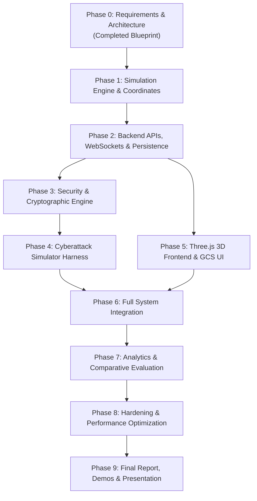

# Staged Development Roadmap (Phases 0–9)
## Drone Communication Security Simulation Platform

---

### Document Information
- **Project:** Drone Communication Security Simulation Platform
- **Phase:** Phase 0 — Requirements and Architecture Blueprint
- **Version:** 1.0.0
- **Status:** APPROVED FOR ARCHITECTURE
- **Classification:** Project Management & Development Plan

---

## 1. Roadmap Overview & Dependency Flow

The development of the platform is divided into 10 structured, progressive phases. Each phase builds upon the verified deliverables of the preceding phase, ensuring that no frontend or security layer is built on an unstable core.

---

## 2. Phase-by-Phase Detailed Specifications

### Phase 0: Requirements & Architecture Blueprint (Current Phase)
- **Objectives:** Establish complete architectural specifications, mathematical models, API contracts, security threat models, attack plans, and roadmap before writing code.
- **Dependencies:** None.
- **Tasks:**
  - Author `docs/requirements.md`.
  - Author `docs/architecture.md`.
  - Author `docs/api-contract.md`.
  - Author `docs/coordinate-system.md`.
  - Author `docs/security-design.md`.
  - Author `docs/attack-test-plan.md`.
  - Author `docs/testing-strategy.md`.
  - Author `docs/development-roadmap.md`.
- **Expected Files:** Entire `docs/` suite.
- **Deliverables:** Fully consistent, cross-referenced documentation set.
- **Acceptance Criteria:** Zero ambiguities in coordinate systems, APIs, or cryptographic specifications.
- **Major Risks:** Scope creep into RF jamming or hardware integration (mitigated by explicit non-goals).
- **Definition of Done (DoD):** All 8 documents committed, reviewed, and aligned.

---

### Phase 1: Drone Simulation Engine & Coordinate System
- **Objectives:** Implement the authoritative backend drone state machine, deterministic kinematic movement calculations, battery model, and geodesic flat-earth coordinate transformations.
- **Dependencies:** Phase 0 documentation.
- **Tasks:**
  - Create project directory skeleton (`backend/app/core/`, `backend/tests/`).
  - Implement `GeoCoordinateService` with forward and inverse transformations.
  - Implement `FlightFSM` with state transitions (`DISARMED`, `ARMED`, `TAKING_OFF`, `HOVERING`, `MOVING`, `LANDING`, `EMERGENCY_LANDING`).
  - Implement `BatteryModel` with linear burn, low-battery warning ($15\%$), and critical failsafe ($5\%$).
  - Implement `DroneEngine` managing the authoritative state vector, geofence clamping ($[-100, 100]\text{ m}$), and command dispatch.
  - Write comprehensive unit tests in `test_drone_engine.py` and `test_coordinates.py`.
- **Expected Files:**
  - `backend/app/core/coordinate_service.py`
  - `backend/app/core/flight_fsm.py`
  - `backend/app/core/battery_model.py`
  - `backend/app/core/drone_engine.py`
  - `backend/tests/test_drone_engine.py`
  - `backend/tests/test_coordinates.py`
- **Deliverables:** Self-contained, framework-agnostic simulation library with 100% passing unit tests.
- **Acceptance Criteria:** 
  - Geodesic conversions accurate to $< 10^{-6}\text{ m}$.
  - State machine rejects invalid transitions.
  - Invariant state preservation on rejected commands.
- **Major Risks:** Numerical integration drift; coordinate sign confusion (mitigated by unit test assertions).
- **Definition of Done (DoD):** `pytest backend/tests/test_drone_engine.py backend/tests/test_coordinates.py` passes with $> 95\%$ coverage.

---

### Phase 2: Backend APIs, WebSockets & Persistence
- **Objectives:** Expose the simulation core via FastAPI REST endpoints, establish the $10\text{ Hz}$ WebSocket telemetry hub, and initialize SQLite persistence in WAL mode.
- **Dependencies:** Phase 1 (Simulation Core).
- **Tasks:**
  - Configure FastAPI application, CORS middleware, and dependency injection.
  - Implement Pydantic data schemas for states, telemetry, and commands.
  - Implement background simulation tick task ($20\text{ Hz}$) using `asyncio`.
  - Implement REST routes: `/health`, `/api/drone/state`, `/api/drone/command`, `/api/drone/telemetry`.
  - Implement `TelemetryHub` broadcasting telemetry frames over `/ws/telemetry`.
  - Implement SQLite database connection with WAL mode and initial tables (`commands`, `security_events`).
  - Write integration tests in `test_api_routes.py` and `test_websockets.py`.
- **Expected Files:**
  - `backend/app/main.py`
  - `backend/app/config.py`
  - `backend/app/schemas/drone_schemas.py`
  - `backend/app/api/routes_drone.py`
  - `backend/app/api/websocket_hub.py`
  - `backend/app/db/database.py`, `models.py`, `repositories.py`
  - `backend/tests/test_api_routes.py`
  - `backend/tests/test_websockets.py`
- **Deliverables:** Runnable FastAPI backend with live WebSocket telemetry streaming and command execution.
- **Acceptance Criteria:**
  - `/health` returns `200 OK`.
  - Commands submitted over REST execute and reflect in WebSocket telemetry within $50\text{ ms}$.
- **Major Risks:** WebSocket client disconnection leaks; database thread locking (mitigated by WAL mode and non-blocking I/O).
- **Definition of Done (DoD):** All API and WebSocket integration tests pass asynchronously.

---

### Phase 3: Security & Cryptographic Engine
- **Objectives:** Implement the modular security pipeline, featuring AES-256-GCM AEAD encryption, HMAC-SHA-256 integrity verification, sliding-window anti-replay filtering, token-bucket rate limiting, and key management.
- **Dependencies:** Phase 2 (Backend Framework & Repositories).
- **Tasks:**
  - Implement `CryptoEngine` utilizing Python `cryptography` library.
  - Implement `AntiReplayFilter` with 64-bit sliding window and timestamp validation.
  - Implement `TokenBucketRateLimiter` ($10\text{ req/s}$, burst $20$).
  - Implement `KeyManager` for CSPRNG key generation and secret isolation.
  - Implement `SecurityPipeline` orchestrator intercepting incoming commands.
  - Implement `/api/security/status` and `/api/security/mode` toggle endpoints.
  - Log security rejection incidents directly to the SQLite `security_events` table.
  - Write security unit and negative tests in `test_security_crypto.py` and `test_anti_replay.py`.
- **Expected Files:**
  - `backend/app/security/crypto_engine.py`
  - `backend/app/security/anti_replay.py`
  - `backend/app/security/rate_limiter.py`
  - `backend/app/security/key_manager.py`
  - `backend/app/security/security_pipeline.py`
  - `backend/app/schemas/security_schemas.py`
  - `backend/app/api/routes_security.py`
  - `backend/tests/test_security_crypto.py`
  - `backend/tests/test_anti_replay.py`
- **Deliverables:** Fully functioning security pipeline capable of operating in `UNSECURED`, `INTEGRITY_ONLY`, and `ENCRYPTED_AUTHENTICATED` modes.
- **Acceptance Criteria:**
  - Corrupted AES-GCM tags reject immediately with HTTP `403`.
  - Duplicate or stale sequence numbers reject with `REPLAY_ATTACK_DETECTED`.
  - Rate limiter blocks requests $> 20$ in burst.
- **Major Risks:** Nonce reuse vulnerability; side-channel or timing leaks (mitigated by standard `cryptography` library primitives).
- **Definition of Done (DoD):** Cryptographic test suite achieves 100% branch coverage on verification and rejection logic.

---

### Phase 4: Cyberattack Simulator Harness
- **Objectives:** Build the automated test runner and attack vector generators for the 6 specified cyberattacks, including state invariant verification.
- **Dependencies:** Phase 3 (Security Engine).
- **Tasks:**
  - Implement `PayloadFactory` crafting malicious frames (unauthorized, tampered, replayed, spoofed, fuzzed, flooded).
  - Implement `AttackRunner` orchestrating attack executions and measuring state deviation.
  - Implement `/api/attacks/{attack_type}` and `/api/attacks/history` endpoints.
  - Record attack runs in the SQLite `attack_runs` table.
  - Write automated attack evaluation tests in `test_attack_scenarios.py` and `test_state_invariants.py`.
- **Expected Files:**
  - `backend/app/attacks/attack_types.py`
  - `backend/app/attacks/payload_factory.py`
  - `backend/app/attacks/attack_runner.py`
  - `backend/app/schemas/attack_schemas.py`
  - `backend/app/api/routes_attacks.py`
  - `backend/tests/test_attack_scenarios.py`
  - `backend/tests/test_state_invariants.py`
- **Deliverables:** Attack injection harness demonstrating vulnerability in `UNSECURED` mode and 100% mitigation in `ENCRYPTED_AUTHENTICATED` mode.
- **Acceptance Criteria:**
  - In `UNSECURED` mode, unauthorized/tampered/replayed commands compromise drone state.
  - In `ENCRYPTED_AUTHENTICATED` mode, all attacks are blocked and authoritative state invariants hold strictly ($\Delta \mathbf{p} = 0$).
- **Major Risks:** Test harness accidentally bypassing the security pipeline (mitigated by testing against the public endpoint).
- **Definition of Done (DoD):** Automated attack test suite runs cleanly via pytest and generates structured database records.

---

### Phase 5: Three.js 3D Frontend & GCS Dashboard
- **Objectives:** Build the interactive web-based Ground Control Station featuring a Three.js 3D simulation environment, HUD gauges, telemetry readouts, flight controls, attack console, and security status.
- **Dependencies:** Phase 2 (Backend APIs & WebSocket Hub).
- **Tasks:**
  - Build HTML5 layout and CSS styling (`index.html`, `css/main.css`, `css/hud.css`).
  - Implement `ws_client.js` with auto-reconnection and telemetry dispatch.
  - Implement `three_viewport.js` rendering the scene, lighting, camera controls, and axes.
  - Implement `world_builder.js` building procedural terrain, runway, helipad $(0, 0, 0)$, and geofence wireframe.
  - Implement `drone_mesh.js` generating a procedural 3D quadcopter model with animated rotors.
  - Implement `trajectory_trail.js` drawing the real-time flight path ribbon.
  - Implement `flight_controls.js` binding buttons and keyboard controls to REST commands.
  - Implement `attack_panel.js` and `security_panel.js` for operator interactions.
- **Expected Files:** Entire `frontend/` directory structure.
- **Deliverables:** High-performance, responsive GCS web interface rendering in any modern browser at $\ge 50\text{ FPS}$.
- **Acceptance Criteria:**
  - Drone model in Three.js moves smoothly according to backend WebSocket updates.
  - Flight controls trigger responsive command execution.
- **Major Risks:** Axis misalignment between backend coordinates and Three.js (mitigated by adherence to `docs/coordinate-system.md`).
- **Definition of Done (DoD):** User can manually fly the drone in 3D using keyboard/button controls while observing live telemetry.

---

### Phase 6: Full System Integration
- **Objectives:** Wire the 3D frontend, attack console, security toggles, and live communication logs into a seamless end-to-end platform.
- **Dependencies:** Phase 4 (Attacks) & Phase 5 (Frontend).
- **Tasks:**
  - Connect the Attack Console UI to `/api/attacks/{attack_type}`.
  - Implement real-time security alert banners on incoming `SECURITY_ALERT` WebSocket frames.
  - Implement live scrolling communication log window color-coded by event status.
  - Connect the security mode toggle switch to `/api/security/mode`.
  - Conduct full end-to-end mission testing with attacks injected during flight.
- **Expected Files:**
  - Updates across `frontend/js/app.js`, `frontend/js/attack_panel.js`, `frontend/js/security_panel.js`.
- **Deliverables:** Unified single-screen application enabling flight control, security configuration, attack injection, and live visual monitoring.
- **Acceptance Criteria:**
  - Injecting an attack in the UI immediately displays visual feedback and updates the 3D drone accordingly (e.g. drone holds position in secured mode vs deviates in unsecured mode).
- **Major Risks:** Frontend event bus synchronization lag (mitigated by lightweight Vanilla JS architecture).
- **Definition of Done (DoD):** End-to-end demonstration executed without browser console errors or backend exceptions.

---

### Phase 7: Analytics & Comparative Evaluation
- **Objectives:** Implement the quantitative analytics engine computing empirical security and performance metrics, and render comparative charts in the GCS dashboard.
- **Dependencies:** Phase 6 (Full System Integration).
- **Tasks:**
  - Implement `MetricsService` calculating $ARR$, $SAR$, $LCSR$, $FRR$, and latency percentiles.
  - Implement `/api/analytics/summary` endpoint.
  - Implement `analytics_view.js` rendering comparative summary tables and visual comparison bars in the frontend.
  - Add database seed utility to load standard benchmark test runs for initial demonstration.
- **Expected Files:**
  - `backend/app/analytics/metrics_service.py`
  - `backend/app/schemas/analytics_schemas.py`
  - `backend/app/api/routes_analytics.py`
  - `frontend/js/analytics_view.js`
- **Deliverables:** Live analytics dashboard presenting calculated empirical metrics comparing secured vs unsecured operations.
- **Acceptance Criteria:**
  - Metrics accurately reflect database audit history without division-by-zero errors on empty datasets.
- **Major Risks:** Misleading or non-reproducible latency measurements (mitigated by high-precision monotonic timing).
- **Definition of Done (DoD):** Dashboard dynamically displays updated comparative metrics following attack runs.

---

### Phase 8: Hardening & Comprehensive Testing
- **Objectives:** Execute end-to-end stress tests, benchmark simulation loop performance, optimize SQLite queries, and harden error-handling across all boundary points.
- **Dependencies:** Phase 7 (Analytics).
- **Tasks:**
  - Execute 10,000-command stress test evaluating CPU, RAM, and tick jitter.
  - Audit all SQLite queries and ensure proper indexing on timestamps and sequence numbers.
  - Verify error boundary handling for abnormal WebSocket drops and malformed JSON bursts.
  - Achieve $> 90\%$ test coverage across all backend modules.
- **Expected Files:**
  - `backend/tests/test_performance.py`
  - `backend/tests/test_state_invariants.py`
- **Deliverables:** Hardened, production-quality simulation platform running stably on baseline hardware.
- **Acceptance Criteria:** Zero memory leaks; zero database lock errors; stable $20\text{ Hz}$ simulation loop.
- **Major Risks:** Host resource exhaustion under rapid request bursts (mitigated by rate limiting).
- **Definition of Done (DoD):** Complete test suite passes with zero failures or deprecation warnings.

---

### Phase 9: Documentation, Report & Final Demonstration
- **Objectives:** Prepare final academic demonstration assets, reproducible user guide, and architectural walkthrough.
- **Dependencies:** Phase 8 (Hardening).
- **Tasks:**
  - Author comprehensive `README.md` with step-by-step installation and execution instructions.
  - Prepare a scripted demonstration walkthrough guide (`docs/demo-guide.md`).
  - Document key findings, benchmark comparisons, and security insights.
- **Expected Files:**
  - `README.md`
  - `docs/demo-guide.md`
- **Deliverables:** Complete academic project package ready for presentation, peer review, and grading.
- **Acceptance Criteria:** A user can clone the repository and launch the full platform in under 3 minutes following the README.
- **Definition of Done (DoD):** All documentation complete, verified, and signed off.
