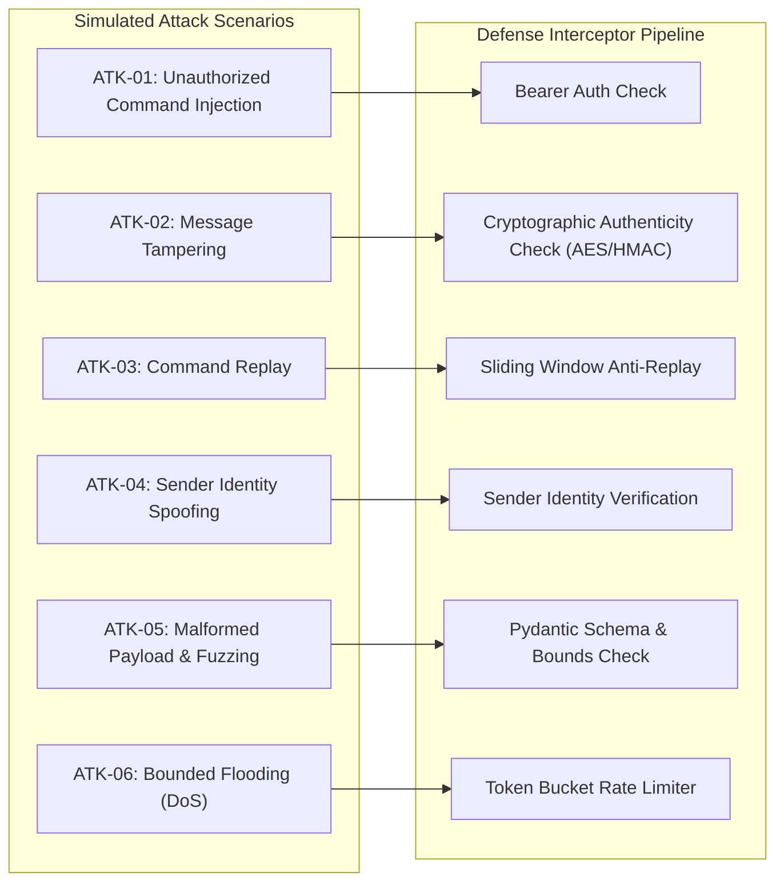

# Cyberattack Simulation & Experiment Methodology

---

## 1. Objectives & Evaluation Protocol

The DroneSec experiment harness provides a controlled, scientific framework to evaluate communication vulnerabilities and verify cryptographic mitigations across UAV command uplinks.

The methodology is governed by four core experimental principles:
1. **Repeatability:** Every test scenario generates deterministic payloads using [`PayloadFactory`](file:///c:/Users/User/Documents/drone/backend/app/attacks/payload_factory.py) with predictable seed parameters.
2. **Authoritative State Isolation:** Between scenarios, the drone simulation engine is initialized to a known baseline (e.g., Airborne Hover at altitude $10.0\text{ m}$) so that motion command rejections reflect security controls rather than flight state machine invalidity.
3. **Zero Impact on Production Infrastructure:** All network traffic targets local loopback interfaces (`127.0.0.1`); no external radio frequency (RF) transmissions are generated.
4. **Separation of Concerns in Outcome Attribution:** Distinguishes security-layer rejections (HTTP 401, 403, 429), schema rejections (HTTP 400, 422), flight-engine rejections (e.g., invalid FSM transition), and transport errors.

---

## 2. Attack Scenario Definitions (ATK-01 to ATK-06)

The simulation platform implements six controlled cyberattack vectors reflecting real-world UAV communication link threats:



### Detailed Scenario Specifications

| Code | Scenario Name | Attack Description | Unsecured Link Outcome | Secured Link Defense Code | Expected HTTP Code |
|---|---|---|---|---|---|
| **ATK-01** | `UNAUTHORIZED_COMMAND` | Dispatches critical flight command (`ARM` or `DISARM`) with omitted or forged Bearer token. | Command executes unconditionally. | `AUTH_TOKEN_MISSING` / `AUTH_TOKEN_INVALID` | 401 Unauthorized |
| **ATK-02** | `MESSAGE_TAMPERING` | Injects bit flips into ciphertext or modifies target coordinates ($+500\text{ m}$) while preserving original signature/tag. | Drone executes modified displacement. | `CRYPTO_DECRYPTION_FAILED` / `HMAC_VERIFICATION_FAILED` | 403 Forbidden |
| **ATK-03** | `COMMAND_REPLAY` | Captures legitimate authenticated command packet and resubmits it at a later timestamp with duplicate sequence number. | Replayed command executes unintended movement again. | `REPLAY_ATTACK_DETECTED` / `TIMESTAMP_OUT_OF_BOUNDS` | 403 Forbidden |
| **ATK-04** | `SENDER_SPOOFING` | Authenticated client (`GCS_CLIENT_B`) claims authoritative GCS identifier (`GCS_STATION_1`) in message header. | Identity accepted; drone executes privileged command. | `SPOOFED_GCS_IDENTITY` | 403 Forbidden |
| **ATK-05** | `MALFORMED_PAYLOAD` | Transmits out-of-bounds parameters, corrupt types, invalid JSON, or missing required keys. | Potential uncaught exception or crash. | `INVALID_SCHEMA` / `INVALID_JSON` / `PAYLOAD_TOO_LARGE` | 400 / 413 / 422 |
| **ATK-06** | `BOUNDED_FLOODING` | High-frequency burst of 30–50 commands dispatched to overwhelm processing queues. | Server queue saturates; CPU spikes. | `RATE_LIMIT_EXCEEDED` | 429 Too Many Requests |

---

## 3. Mathematical State Invariance Verification

For every scenario execution under active defense, the test runner evaluates the state integrity function $\mathcal{I}(S_0, S_1)$:

$$\mathcal{I}(S_0, S_1) = \begin{cases} 
\text{True (Pass)}, & \text{if } S_1.\text{state\_version} = S_0.\text{state\_version} \;\land\; \|S_1.\mathbf{p} - S_0.\mathbf{p}\| = 0 \\
\text{False (Compromised)}, & \text{otherwise}
\end{cases}$$

Where:
- $S_0$ is the state snapshot immediately prior to attack injection.
- $S_1$ is the state snapshot immediately after attack completion.
- $\mathbf{p} = (x, y, z)$ represents authoritative Cartesian drone coordinates in meters.
- `state_version` is the authoritative 64-bit monotonic state counter.

---

## 4. Automated Evaluation Framework Implementation

The automated evaluation framework consists of three orchestrated components:
1. [`EvaluationRunner`](file:///c:/Users/User/Documents/drone/backend/app/evaluation/runner.py): Executes 21 automated experiments (7 scenarios $\times$ 3 operating modes).
2. [`AttackScenarioRunner`](file:///c:/Users/User/Documents/drone/backend/app/attacks/scenario_runner.py): Manages individual scenario runs, records per-attempt latencies, HTTP response codes, and verifies state invariant preservation.
3. [`EvaluationRepository`](file:///c:/Users/User/Documents/drone/backend/app/persistence/repositories.py): Persists structured run summaries and experiment results into SQLite tables `evaluation_runs` and `evaluation_experiments`.

---

## 5. Local Reproduction Procedures

To execute and verify the full empirical evaluation suite locally:

```bash
# 1. Start backend server
uvicorn backend.app.main:app --port 8000

# 2. Trigger integration verification gate (pre-flight checks)
curl -X POST http://127.0.0.1:8000/api/evaluation/verify

# 3. Trigger full 21-experiment evaluation suite
curl -X POST http://127.0.0.1:8000/api/evaluation/run

# 4. Run local performance benchmarks (command latency, concurrency, telemetry)
python -m backend.scripts.run_benchmarks
```
