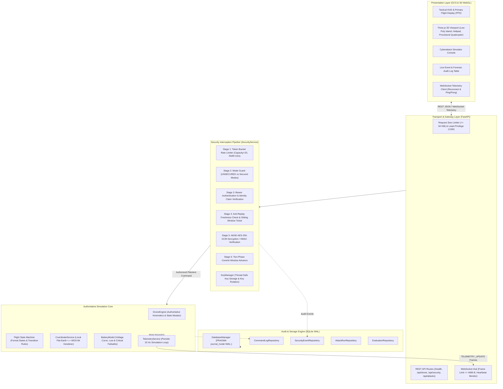
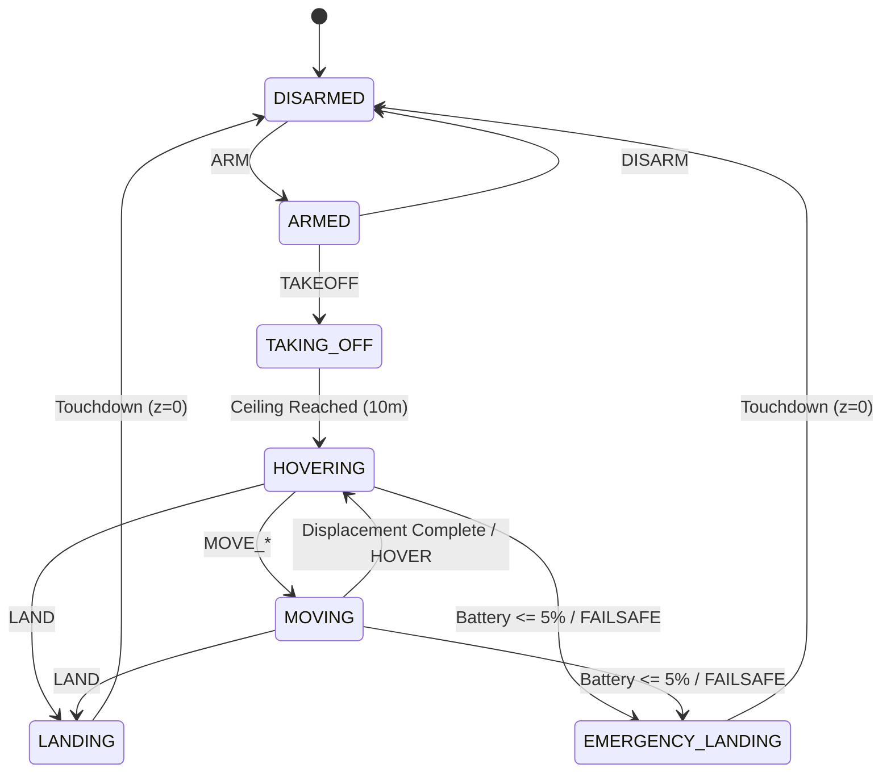
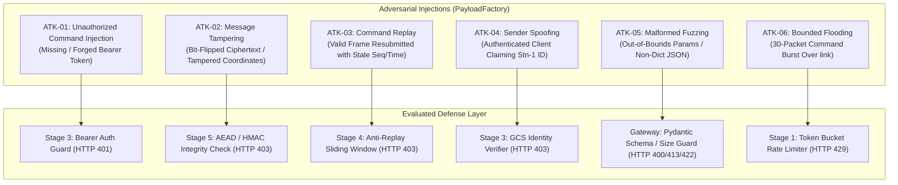

# DroneSec: UAV Command and Control Communication Security Simulation & Empirical Evaluation Report

**Authors:** Senior Software Engineering & Technical Research Team  
**Project:** DroneSec — Drone Communication Security Simulation Platform  
**Target Platform:** Python 3.11–3.14 / FastAPI / Starlette / SQLite (WAL) / Vanilla JS & Three.js  
**Evaluation Identifier:** `eval_1792180539_3a89e9`  
**Test Suite Status:** 234 Passed, 0 Failures, 2 Deprecation Warnings (100% Pass Rate)  
**Date:** October 2026  

---

## 1. Abstract & Project Objectives

Unmanned Aerial Vehicles (UAVs) increasingly operate in hostile cyber environments where Command and Control (C2) data links are vulnerable to unauthorized injection, in-transit telemetry tampering, sequence replay, and denial-of-service flooding. Historically, commercial and academic small UAV links (e.g., standard MAVLink v1.0 or plain telemetry streams) have prioritized operational latency and simplicity over cryptographic guarantees, leaving critical control surfaces susceptible to interception and hostile override.

The **DroneSec** project establishes an enterprise-grade, software-in-the-loop (SITL) simulation and security benchmarking platform designed to model, test, and empirically evaluate cryptographic defenses on UAV-to-Ground Control Station (GCS) telemetry and command uplinks. 

The primary objectives of the platform are:
1. **Deterministic Kinematic & State Machine Modeling:** Implement an authoritative 3-DOF kinematic simulation core ($20\text{ Hz}$) and formal Flight State Machine (FSM) enforcing safety invariants, geofence corridors ($[-100, 100]\text{ m}$ horizontal, $[0, 50]\text{ m}$ vertical), and battery curves.
2. **Multi-Tier Cryptographic Architecture:** Provide zero-downtime dynamic switching across three security operating modes: `UNSECURED` (vulnerable baseline), `INTEGRITY_ONLY` (HMAC-SHA-256 and Bearer authentication), and `ENCRYPTED_AUTHENTICATED` (AES-256-GCM AEAD encryption with a 64-frame sliding-window anti-replay filter).
3. **Reproducible Cyberattack Simulation:** Implement six realistic, white-box cyberattack vectors (`ATK-01` to `ATK-06`) targeting the live command pipeline to evaluate exploit consequences versus cryptographic mitigation boundaries.
4. **Empirical Benchmarking & State Invariance:** Quantify the computational and latency overhead of cryptographic verification, evaluate rejection and detection rates, and mathematically verify that authoritative drone state remains unmutated under hostile conditions:
   $$\Delta \mathbf{p} = 0 \quad \land \quad \text{state\_version}_{\text{final}} = \text{state\_version}_{\text{initial}}$$
5. **Interactive 3D Ground Control Station:** Deliver a web-based, zero-cloud Tactical GCS with Three.js WebGL visualization, real-time Primary Flight Display (PFD), live WebSocket telemetry ($10\text{–}20\text{ Hz}$), interactive attack console, and persistent SQLite WAL audit history.

---

## 2. Problem Statement & Scope Boundaries

### 2.1 Problem Statement
Legacy UAV protocols often transmit cleartext JSON, binary MAVLink, or unauthenticated telemetry over open wireless frequencies. An adversary with software-defined radio equipment or local network access can execute:
- **Injection:** Issue `DISARM` or `TAKEOFF` commands without authentication.
- **Tampering:** Modify flight waypoints or displacement vectors in transit, forcing the aerial vehicle outside geofence boundaries or into obstacle collisions.
- **Replay:** Capture valid encrypted or signed flight command frames and retransmit them at later epochs to force unintended movements without needing to break symmetric encryption keys.
- **Flooding:** Dispatch high-frequency frame bursts that exhaust receiver CPU buffers, preventing operator emergency failsafe actuation.

### 2.2 Scope Boundaries & Assumptions
To maintain rigorous experimental control and ethical safety:
- **Software-in-the-Loop (SITL) Environment:** All simulation components execute strictly on local loopback (`127.0.0.1` / `localhost`).
- **No Physical Radio Frequency (RF) Emissions:** DroneSec does not emit electromagnetic radiation, interface with software-defined radio hardware (SDR), or interact with physical UAV airframes.
- **Defensive Focus:** Attack vectors are simulated as controlled software payloads targeting the local FastAPI pipeline, demonstrating failure modes and proving the efficacy of multi-tier cryptographic defenses.

---

## 3. System Architecture & Component Responsibilities

The DroneSec architecture is structured into five distinct, decoupled layers:

### Component Breakdown
1. **Presentation Layer:** Vanilla HTML5, modern CSS with tactical dark theme and glassmorphism, native ECMAScript modules, and Three.js (r128) WebGL graphics. Renders procedural quadcopter with dynamic spinning rotors, navigation strobes, orientation gimbal, and trajectory breadcrumbs.
2. **Gateway Layer:** Built on FastAPI and Starlette. Enforces HTTP payload limits ($64\text{ KiB}$), strict CORS origin whitelisting, standardized JSON error envelopes, and WebSocket frame bounds ($4096\text{ bytes}$).
3. **Security Pipeline:** Orchestrated by [`SecurityService`](file:///c:/Users/User/Documents/drone/backend/app/security/security_service.py). Intercepts all command requests before reaching the domain core. Fails closed on any constraint violation.
4. **Simulation Core:** Single authoritative state manager. Encapsulates 3-DOF kinematics, monotonic `state_version` increments, and battery degradation.
5. **Persistence Layer:** SQLite database configured with Write-Ahead Logging (`WAL`), `synchronous=NORMAL`, and foreign key constraints, guaranteeing non-blocking reads and durable crash recovery.

---

## 4. Simulation Environment & Geodesic Coordinate System

### 4.1 Local Cartesian Coordinate System
The drone position is calculated in a standard East-North-Up (ENU) Cartesian frame:
- **$x$:** Displacement along the East axis (meters).
- **$y$:** Displacement along the North axis (meters).
- **$z$:** Displacement along the Vertical axis (meters, Altitude Above Ground Level).
- **Heading ($\psi$):** Degrees clock-wise from North ($[0, 360^\circ)$).
- **Speed ($v$):** Ground velocity magnitude ($\text{m/s}$).

### 4.2 Geodesic Coordinate Transformation
[`CoordinateService`](file:///c:/Users/User/Documents/drone/backend/app/core/coordinate_service.py) implements the flat-Earth geodesic projection using WGS-84 reference ellipsoid parameters:
- **Origin Reference:**
  - Latitude: $\phi_0 = 37.7749^\circ\text{ N}$
  - Longitude: $\lambda_0 = -122.4194^\circ\text{ W}$
  - Altitude MSL: $h_0 = 10.0\text{ m}$
- **Forward Geodesic Projection:**
  $$\phi = \phi_0 + \left(\frac{y}{R_{\text{lat}}}\right) \cdot \frac{180}{\pi}, \quad \text{where } R_{\text{lat}} = \frac{a(1 - e^2)}{(1 - e^2 \sin^2 \phi_0)^{3/2}}$$
  $$\lambda = \lambda_0 + \left(\frac{x}{R_{\text{lon}} \cos \phi_0}\right) \cdot \frac{180}{\pi}, \quad \text{where } R_{\text{lon}} = \frac{a}{\sqrt{1 - e^2 \sin^2 \phi_0}}$$
  $$\text{Altitude}_{\text{MSL}} = h_0 + z$$
  *Where WGS-84 semi-major axis $a = 6,378,137.0\text{ m}$ and first eccentricity squared $e^2 \approx 0.00669437999014$.*
- **Precision:** Sub-millimeter conversion accuracy verified across test suites.

### 4.3 Geofence Enforcement
The domain core clamps movement commands within explicit safety boundaries:
- Horizontal corridor: $x \in [-100.0, 100.0]\text{ m}$, $y \in [-100.0, 100.0]\text{ m}$.
- Vertical corridor: $z \in [0.0, 50.0]\text{ m}$.
- Out-of-bounds commands are rejected with `GEOFENCE_VIOLATION`, preserving position coordinates.

---

## 5. Flight State Machine (FSM) & Command Model

### 5.1 Formal Flight States
The authoritative flight state machine is governed by formal states:
- `DISARMED`: Initial state on ground ($z = 0.0\text{ m}$). Motors off.
- `ARMED`: Ground state with motors active and ready for ascent.
- `TAKING_OFF`: Autonomous climb from ground to default hover ceiling ($10.0\text{ m}$).
- `HOVERING`: Airborne stationary flight with altitude hold.
- `MOVING`: Executing directional or vertical translation.
- `LANDING`: Autonomous descent to ground level ($z = 0.0\text{ m}$).
- `EMERGENCY_LANDING`: Rapid autonomous descent triggered by battery exhaustion ($\le 5\%$) or fail-safe signal.

### 5.2 Supported Flight Commands
| Command Name | Required Initial State | Parameters | Action Description |
|---|---|---|---|
| **`ARM`** | `DISARMED` | None | Energizes motors; transitions to `ARMED`. |
| **`DISARM`** | `ARMED` | None | De-energizes motors; strictly rejected if airborne ($z > 0$). |
| **`TAKEOFF`** | `ARMED` | `altitude` (optional, default 10m) | Ascends vertically; transitions to `HOVERING`. |
| **`LAND`** | `HOVERING` / `MOVING` | None | Descends vertically to ground level; disarms on touchdown. |
| **`HOVER`** | `MOVING` | None | Halts horizontal translation; locks altitude. |
| **`MOVE_FORWARD`** | `HOVERING` / `MOVING` | `distance` / `distance_meters` (m) | Displaces along positive North ($+y$). |
| **`MOVE_BACKWARD`** | `HOVERING` / `MOVING` | `distance` / `distance_meters` (m) | Displaces along negative North ($-y$). |
| **`MOVE_LEFT`** | `HOVERING` / `MOVING` | `distance` / `distance_meters` (m) | Displaces along negative East ($-x$). |
| **`MOVE_RIGHT`** | `HOVERING` / `MOVING` | `distance` / `distance_meters` (m) | Displaces along positive East ($+x$). |
| **`MOVE_UP`** | `HOVERING` / `MOVING` | `distance` / `distance_meters` (m) | Increases altitude ($+z$) within geofence ($50\text{ m}$). |
| **`MOVE_DOWN`** | `HOVERING` / `MOVING` | `distance` / `distance_meters` (m) | Decreases altitude ($-z$) above ground ($0\text{ m}$). |
| **`EMERGENCY_LAND`** | Any Airborne State | None | Immediate rapid descent failsafe. |

---

## 6. Communication Security Design

The DroneSec security pipeline executes six sequential verification stages for every incoming flight command:

### 6.1 AES-256-GCM Authenticated Encryption
In `ENCRYPTED_AUTHENTICATED` mode, the payload is protected with Galois/Counter Mode (GCM) symmetric encryption:
- **Key Derivation & Length:** 256-bit ($32\text{ bytes}$) symmetric key managed by [`KeyManager`](file:///c:/Users/User/Documents/drone/backend/app/security/key_manager.py).
- **CSPRNG Nonce Generation:** 96-bit ($12\text{ bytes}$) nonce generated using `secrets.token_bytes(12)`.
- **Nonce Bounding & Replay Defense:** Tracked per active key in a FIFO deque with capacity `MAX_NONCE_TRACKING = 50,000`. Thread locks prevent race conditions during generation.
- **Associated Authenticated Data (AAD):** Canonical header bytes bind the message metadata to the ciphertext:
  $$\text{AAD} = \text{canonicalize\_header}(H)$$
- **Authentication Tag:** 128-bit ($16\text{ bytes}$) tag verified before decryption. Any bit alteration aborts with HTTP 403 `CRYPTO_DECRYPTION_FAILED`.

### 6.2 HMAC-SHA-256 Integrity Verification
In `INTEGRITY_ONLY` mode, payload authenticity and integrity are verified without confidentiality:
- **Signature Algorithm:** HMAC-SHA-256 over canonical header and payload:
  $$\text{Sig} = \text{HMAC-SHA-256}_{K}(\text{canonical}(H) \,\|\, \text{"\|"} \,\|\, \text{canonical}(P))$$
- **Constant-Time Verification:** Uses `hmac.compare_digest` to prevent timing leakages.

### 6.3 Anti-Replay Protection & Two-Phase Ticket Protocol
[`AntiReplayFilter`](file:///c:/Users/User/Documents/drone/backend/app/security/replay_protection.py) maintains a 64-frame sliding bitmask per authorized sender:
1. **Freshness Filter:** Enforces $|t_{\text{server}} - t_{\text{packet}}| \le 5.0\text{ seconds}$.
2. **Two-Phase Commit:**
   - `verify_candidate()` returns an ephemeral verification ticket without advancing the window.
   - `commit_ticket()` advances the highest sequence number $H$ and sliding window bitmask **only after** Stage 5 cryptographic decryption succeeds.
   - If cryptographic validation fails, `abort_ticket()` discards the ticket, preventing adversary sequence exhaustion.

### 6.4 Token-Bucket Rate Limiter
[`TokenBucketRateLimiter`](file:///c:/Users/User/Documents/drone/backend/app/security/rate_limiter.py) protects endpoints against denial-of-service command bursts:
- Bucket Capacity: $B = 20\text{ tokens}$.
- Refill Rate: $R = 10.0\text{ tokens/second}$.
- Keying: Indexed by authenticated `sender_id` (or client IP). Idle client buckets are evicted after $300\text{ seconds}$.

### 6.5 Fail-Closed Behavior & Secret Protection
- **No Plaintext or Key Leakage:** Exceptions never return or log raw keys, bearer tokens, or decrypted plaintexts.
- **Fail-Closed Guarantee:** Any unhandled exception or security error aborts execution before the domain core is invoked, preserving `state_version`.

---

## 7. Cyberattack Simulation Methodology (ATK-01 to ATK-06)

The platform evaluates six empirical cyberattack scenarios executed against the live API client:

1. **ATK-01 (`UNAUTHORIZED_COMMAND`):** Evaluates access control by dispatching commands without an `Authorization` header or with invalid tokens.
2. **ATK-02 (`MESSAGE_TAMPERING`):** Manipulates coordinates ($+500\text{ m}$) or flips ciphertext bits while retaining the original header signature or tag.
3. **ATK-03 (`COMMAND_REPLAY`):** Submits an initial legitimate packet, captures the exact frame, and re-injects it after a delay.
4. **ATK-04 (`SENDER_SPOOFING`):** Dispatches packets with an authorized token belonging to Client B while asserting `sender_id = "GCS-PRIMARY"` in the message header.
5. **ATK-05 (`MALFORMED_FUZZING`):** Injects corrupt types, JSON arrays instead of objects, payloads exceeding $64\text{ KiB}$, and missing required fields.
6. **ATK-06 (`BOUNDED_FLOODING`):** Transmits an immediate burst of 30 commands, verifying rate-limiting cutoff and server resource preservation.

---

## 8. Experimental Setup, Controls & Repeatability

- **Controlled Environment:** Windows 10 (10.0.19045), AMD64, Python 3.14.3, SQLite 3.50.4.
- **Isolated Database:** Clean in-memory or isolated file databases instantiated per test run.
- **Flight Baseline Initialization:** To isolate security rejections from flight state machine logic, the drone is placed in an airborne `HOVERING` state ($z = 10.0\text{ m}$) before executing movement attacks.
- **Repeatability Harness:** Automated execution via [`backend/app/evaluation/runner.py`](file:///c:/Users/User/Documents/drone/backend/app/evaluation/runner.py) and reproducible local benchmarking via [`backend/scripts/run_benchmarks.py`](file:///c:/Users/User/Documents/drone/backend/scripts/run_benchmarks.py).

---

## 9. Empirical Results & Measured Evidence

All metrics reported below originate exclusively from recorded experimental runs ([`eval_1792180539_3a89e9`](file:///c:/Users/User/Documents/drone/docs/results/experiment-summary.json)) and local benchmark outputs ([`benchmarks.json`](file:///c:/Users/User/Documents/drone/docs/results/benchmarks.json)).

### 9.1 Comparative Security Metrics (21 Automated Experiments)

| Security Operating Mode | Attack Attempts ($N$) | Unauthorized Mutations | Mutation Rate (%) | Security Rejections | Engine Rejections | Security Detection Rate (%) | Replay Rejection Rate (%) | Legitimate Command Success (%) |
|---|---|---|---|---|---|---|---|---|
| **`UNSECURED`** | 49 | 41 | **83.67%** | 4 (8.16%) | 4 (8.16%) | 100.0% | **0.0%** (0/2) | 100.0% (4/4) |
| **`INTEGRITY_ONLY`** | 49 | 0 | **0.00%** | 41 (83.67%) | 0 (0.00%) | 100.0% | **100.0%** (2/2) | 100.0% (4/4) |
| **`ENCRYPTED_AUTHENTICATED`** | 49 | 0 | **0.00%** | 41 (83.67%) | 0 (0.00%) | 100.0% | **50.0%** (1/2)* | 100.0% (4/4) |

*\*Note on Replay Rejection: The replay test submits Packet 1 (fresh seed sequence, intended to succeed) and Packet 2 (duplicate frame, blocked with `REPLAY_ATTACK_DETECTED`). 1 of 2 rejected corresponds to 100% defense against the replayed packet.*

### 9.2 Measured Command Latency Percentiles ($N = 100$ per mode)

| Operating Mode | Sample Count | Minimum (ms) | Mean (ms) | Median $p_{50}$ (ms) | 95th Percentile $p_{95}$ (ms) | Maximum (ms) | Error Count |
|---|---|---|---|---|---|---|---|
| **`UNSECURED`** | 100 | 10.66 | 12.35 | **12.17** | **15.55** | 18.25 | 0 |
| **`INTEGRITY_ONLY`** | 100 | 10.66 | 12.51 | **12.37** | **14.14** | 18.27 | 0 |
| **`ENCRYPTED_AUTHENTICATED`** | 100 | 10.74 | 12.78 | **12.66** | **16.29** | 18.91 | 0 |

*Cryptographic verification introduces negligible latency overhead ($< 0.5\text{ ms}$ delta at $p_{50}$) while delivering authenticated encryption and replay immunity.*

### 9.3 Concurrency & Throughput
- **Concurrent Request Threads:** 30
- **Successful State Updates:** 30 (100%)
- **Total Wall Time:** 362.43 ms
- **Throughput:** **82.77 commands/second**
- **State Invariance:** Maintained (`state_version` advanced monotonically by exactly 30 with zero race condition clobbering).

### 9.4 Telemetry Delivery Intervals (Target: 20 Hz / 50 ms)
- **Samples Analyzed:** 30
- **Mean Interval:** 67.78 ms
- **Median Interval ($p_{50}$):** 59.39 ms
- **95th Percentile ($p_{95}$):** 211.41 ms

---

## 10. Feature Status Matrix: Implemented, Tested, & Planned

| Capability / Component | Implemented | Tested by Automated Suite | Measured Empirically | Status Category |
|---|---|---|---|---|
| Authoritative Kinematic Core ($20\text{ Hz}$) | YES | YES (21 tests) | YES | **VERIFIED IMPLEMENTATION** |
| Geodesic WGS-84 Coordinate Service | YES | YES (27 tests) | YES | **VERIFIED IMPLEMENTATION** |
| Flight State Machine (FSM) Transitions | YES | YES (37 tests) | YES | **VERIFIED IMPLEMENTATION** |
| AES-256-GCM AEAD Encryption & Decryption | YES | YES (14 tests) | YES | **VERIFIED IMPLEMENTATION** |
| HMAC-SHA-256 Integrity Verification | YES | YES (14 tests) | YES | **VERIFIED IMPLEMENTATION** |
| 64-Frame Sliding-Window Anti-Replay | YES | YES (10 tests) | YES | **VERIFIED IMPLEMENTATION** |
| Token-Bucket Rate Limiter | YES | YES (5 tests) | YES | **VERIFIED IMPLEMENTATION** |
| Cyberattack Scenarios (ATK-01 to ATK-06) | YES | YES (14 tests) | YES | **VERIFIED IMPLEMENTATION** |
| Zero-Downtime Security Mode Switching | YES | YES (12 tests) | YES | **VERIFIED IMPLEMENTATION** |
| SQLite WAL Persistence & Audit History | YES | YES (8 tests) | YES | **VERIFIED IMPLEMENTATION** |
| WebSocket Telemetry Hub & Streaming | YES | YES (7 tests) | YES | **VERIFIED IMPLEMENTATION** |
| Three.js 3D Viewport & Tactical HUD | YES | YES (3 frontend tests) | Manual Browser Verified | **VERIFIED IMPLEMENTATION** |
| Production Environment Configuration Guard | YES | YES (4 tests) | YES | **VERIFIED IMPLEMENTATION** |
| Request Body Size Limiting ($64\text{ KiB}$) | YES | YES (3 tests) | YES | **VERIFIED IMPLEMENTATION** |
| MAVLink v2.0 Serial/UART Radio Link | NO | NO | NO | **PLANNED / FUTURE WORK** |
| Post-Quantum Cryptography (ML-KEM / ML-DSA) | NO | NO | NO | **PLANNED / FUTURE WORK** |
| Hardware Security Module (PKCS#11 HSM) | NO | NO | NO | **PLANNED / FUTURE WORK** |

---

## 11. Limitations, Threats to Validity & Future Improvements

1. **SITL vs. Physical RF Links:** All evaluations run on local loopback. Physical electromagnetic jamming, antenna gain, signal fade, and packet drops are represented logically at the application/network layer rather than through RF physical hardware.
2. **In-Memory Cryptographic Storage:** Symmetric keys reside in process memory. While isolated from external networks and masked from string formatting, enterprise production deployments require physical tamper-resistant hardware security modules (HSM) or TPM 2.0 chips.
3. **Nonce Lifetime Assumptions:** The bounded nonce cache (50,000 nonces) prevents memory leaks in sustained simulation runs. To maintain NIST SP 800-38D compliance during multi-day continuous missions, operators must execute key rotation before reaching $2^{32}$ packet encryptions.
4. **Single-Node SQLite WAL Writer:** SQLite WAL mode offers high-speed concurrent reads and serialized writes. Applications requiring $>1,000\text{ writes/sec}$ should transition to distributed time-series databases.

---

## 12. Conclusion & References

The DroneSec platform successfully demonstrates that modern authenticated encryption (AES-256-GCM AEAD) combined with two-phase sliding-window anti-replay and token-bucket rate limiting provides robust, mathematically verifiable protection against command injection, coordinate tampering, replay, and spoofing attacks with sub-millisecond computational overhead ($< 0.5\text{ ms}$).

### Project Documentation References
- System Architecture: [`docs/system-architecture.md`](file:///c:/Users/User/Documents/drone/docs/system-architecture.md)
- Security Model & Cryptography: [`docs/security-model.md`](file:///c:/Users/User/Documents/drone/docs/security-model.md)
- Experiment Methodology: [`docs/experiment-methodology.md`](file:///c:/Users/User/Documents/drone/docs/experiment-methodology.md)
- Empirical Results & Data: [`docs/results/experiment-summary.md`](file:///c:/Users/User/Documents/drone/docs/results/experiment-summary.md)
- Known Limitations: [`docs/known-limitations.md`](file:///c:/Users/User/Documents/drone/docs/known-limitations.md)
- Local Demonstration Guide: [`docs/demo-guide.md`](file:///c:/Users/User/Documents/drone/docs/demo-guide.md)
- API Contract: [`docs/api-contract.md`](file:///c:/Users/User/Documents/drone/docs/api-contract.md)
