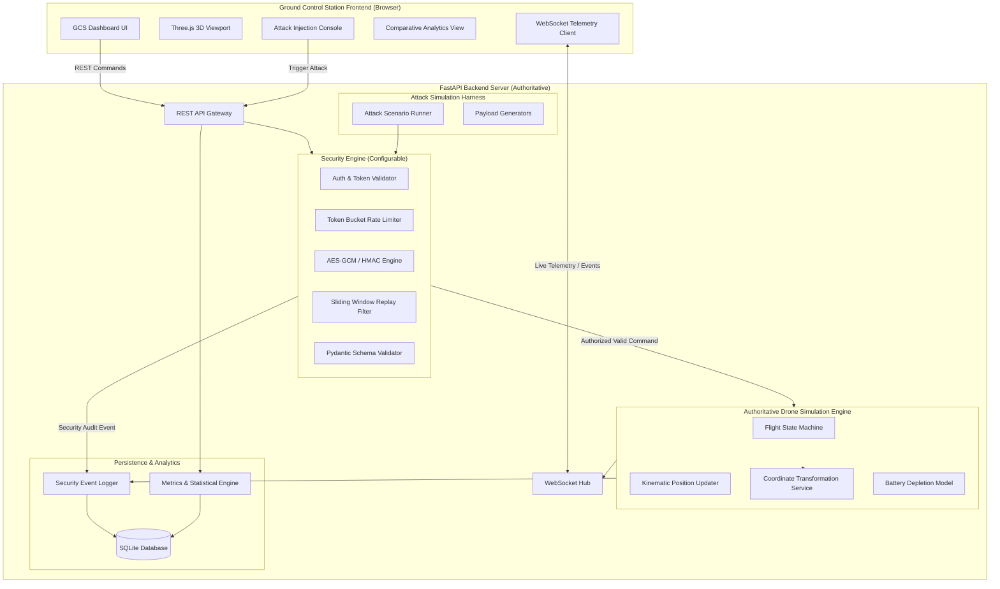
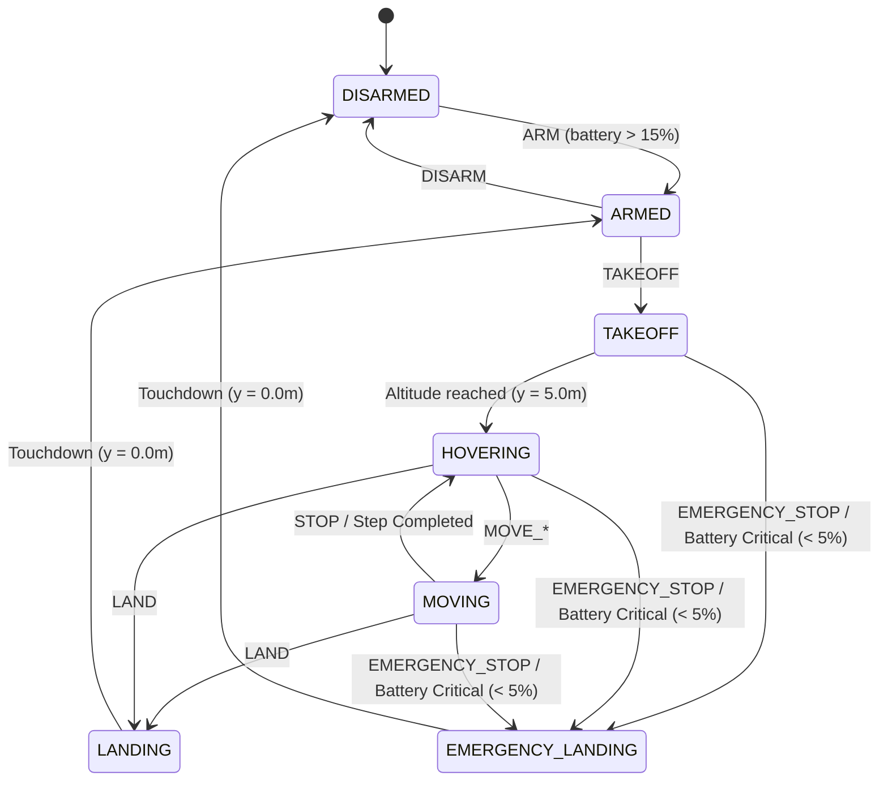

# Software Requirements Specification (SRS)
## Drone Communication Security Simulation Platform (Phase 0)

---

### Document Information
- **Project:** Drone Communication Security Simulation Platform
- **Phase:** Phase 0 — Requirements and Architecture Blueprint
- **Version:** 1.0.0
- **Status:** APPROVED FOR ARCHITECTURE
- **Classification:** Educational & Research Simulation / Communication Security Benchmark

---

## 1. System Vision & Purpose

### 1.1 Executive Summary
The **Drone Communication Security Simulation Platform** is a lightweight, local-first web application designed to demonstrate, analyze, and benchmark cybersecurity principles applied to unmanned aerial vehicle (UAV) Ground Control Station (GCS) telemetry and command links. 

The platform simulates a virtual drone operating in a 3D environment, an interactive GCS flight dashboard, a configurable communication security engine (evaluating unencrypted, authenticated-only, and authenticated-encrypted channels), an automated cyberattack injection harness, and live security telemetry with quantitative analytics.

### 1.2 Pedagogical & Research Objectives
1. **Demonstrate Vulnerabilities:** Visually and empirically demonstrate the impact of classic wireless command-and-control (C2) attacks (unauthorized command injection, message tampering, replay attacks, identity spoofing, payload fuzzing, and rate-limit exhaustion) on an unsecured drone link.
2. **Demonstrate Defenses:** Illustrate how modern application-layer cryptographic mechanisms (AES-256-GCM AEAD, HMAC-SHA-256 integrity verification, sliding-window sequence tracking, strict schema validation, and token-bucket rate limiting) nullify these attack vectors.
3. **Quantitative Comparative Analytics:** Provide empirical comparative metrics (latency overhead, throughput, attack detection rate, false rejection rate, state deviation) between secured and unsecured configurations.

### 1.3 Target Execution Environment & Resource Profile
The system is explicitly engineered to run locally without cloud dependencies, external proprietary APIs, or specialized hardware:
- **Host Hardware:** Typical student/developer workstation (Baseline: 4-Core CPU, 16 GB RAM, NVIDIA RTX 3050 4 GB GPU or integrated GPU).
- **Host OS:** Cross-platform (Windows 10/11, macOS, Ubuntu 22.04+).
- **Runtime Stack:** Python 3.10+ (FastAPI/Pydantic/Uvicorn), SQLite 3, Modern Browser (Chrome/Edge/Firefox with WebGL support).
- **Execution Mode:** Local-first, zero external network calls during runtime.

### 1.4 Scope Boundaries & Non-Goals
To maintain architectural integrity and prevent scope creep, the following boundaries are strictly enforced:
- **IN SCOPE:**
  - Software-only application-layer and transport-layer communication security.
  - Deterministic kinematic drone flight simulation with authoritative backend state.
  - Interactive 3D visualization using Three.js in a modern web browser.
  - Automated and manual attack injection against the local simulator loop.
  - Relational persistence of security events and comparative analytics calculations.
- **OUT OF SCOPE (NON-GOALS):**
  - **RF Jamming:** Radio frequency physical-layer jamming, signal attenuation, and electromagnetic interference are explicitly excluded.
  - **Aerodynamic Flight Dynamics:** Complex six-degree-of-freedom (6-DoF) aerodynamics, wind gusts, rotor blade dynamics, and sensor noise modeling are out of scope.
  - **Physical Drone Hardware:** Integration with MAVLink hardware, PX4/ArduPilot autopilots, SDRs (Software Defined Radios), or physical drones is excluded.
  - **Autonomous AI / Computer Vision:** Autonomous obstacle avoidance, computer vision tracking, or neural network navigation are excluded.
  - **Cloud Infrastructure:** Multi-tenant cloud deployments, Kubernetes orchestration, or paid third-party security services are excluded.

---

## 2. System Architecture & Context

---

## 3. Subsystem Functional Requirements

### Subsystem A: Virtual Drone Engine

#### FR-A.1 Authoritative Backend Ownership
The backend server shall be the sole authoritative source of drone truth. The frontend or external callers must never directly manipulate drone state variables. All state changes shall occur through discrete, validated command execution or periodic simulation tick updates.

#### FR-A.2 Drone State Vector
The authoritative drone state vector shall maintain the following properties:
| Property | Type | Units / Format | Description |
|---|---|---|---|
| `state_version` | Integer | Monotonic counter | Incremented on every tick or command execution. |
| `timestamp` | Float | Seconds (Unix epoch) | Server timestamp of the state capture. |
| `flight_state` | Enum | String | Current flight state (`DISARMED`, `ARMED`, `TAKING_OFF`, `HOVERING`, `MOVING`, `LANDING`, `EMERGENCY_LANDING`). |
| `x` | Float | Metres | Local East-West displacement from local origin (East is positive). |
| `y` | Float | Metres | Local altitude above ground reference (Up is positive, Ground = 0.0). |
| `z` | Float | Metres | Local North-South displacement from local origin (North is positive). |
| `latitude` | Float | Degrees (-90.0 to 90.0) | Derived geographic latitude based on local origin. |
| `longitude` | Float | Degrees (-180.0 to 180.0) | Derived geographic longitude based on local origin. |
| `altitude_msl` | Float | Metres | Derived Mean Sea Level altitude (`origin_alt + y`). |
| `heading` | Float | Degrees (0.0 to 359.9) | Compass heading ($0^\circ = \text{North}$, $90^\circ = \text{East}$, $180^\circ = \text{South}$, $270^\circ = \text{West}$). |
| `speed` | Float | Metres / second | Current linear ground/air speed. |
| `battery_level` | Float | Percentage (0.0 to 100.0) | Remaining battery capacity. |
| `armed` | Boolean | True/False | Arming safety interlock. |
| `last_command_id` | String / UUID | UUIDv4 | Identifier of the last successfully executed command. |

#### FR-A.3 Supported Flight Commands
The engine shall process the following discrete commands:
1. `ARM`: Arms propulsion systems; permitted only when `flight_state == DISARMED` and `battery_level > 15.0`.
2. `DISARM`: Disarms propulsion systems; permitted only when `flight_state == ARMED` or on the ground (`y == 0.0`).
3. `TAKEOFF`: Commands the drone to take off to a standard hover altitude (default: $y = 5.0\text{ m}$). Permitted only when `flight_state == ARMED`.
4. `LAND`: Commands the drone to gently descend from current altitude to $y = 0.0\text{ m}$ at landing speed, then transition to `ARMED` or `DISARMED`.
5. `MOVE_FORWARD`: Displaces drone along positive North axis ($+Z$) by configured step increment ($2.0\text{ m}$) or initiates forward velocity.
6. `MOVE_BACKWARD`: Displaces drone along negative North axis ($-Z$) by configured step increment ($2.0\text{ m}$).
7. `MOVE_LEFT`: Displaces drone along negative East axis ($-X$) by configured step increment ($2.0\text{ m}$).
8. `MOVE_RIGHT`: Displaces drone along positive East axis ($+X$) by configured step increment ($2.0\text{ m}$).
9. `STOP`: Halts active horizontal displacement and stabilizes into `HOVERING` state.
10. `EMERGENCY_STOP`: Immediate safety cutoff. Initiates controlled emergency descent (`EMERGENCY_LANDING`) at maximal safe descent rate ($3.0\text{ m/s}$).

#### FR-A.4 State Machine & Valid Transitions

#### FR-A.5 Battery Depletion & Safety Rules
- Idle battery burn: $0.02\%$ per second when `ARMED` or `HOVERING`.
- Movement battery burn: $0.08\%$ per second or $0.1\%$ per meter displaced.
- Takeoff battery burn: Fixed $1.0\%$ per takeoff operation.
- **Failsafe Trigger 1 (Low Battery):** When `battery_level <= 15.0%`, forward/backward/left/right movement commands are rejected; only `LAND` or `STOP` is accepted.
- **Failsafe Trigger 2 (Critical Battery):** When `battery_level <= 5.0%`, the engine initiates automatic `EMERGENCY_LANDING` regardless of active commands.

#### FR-A.6 Geofencing & World Boundaries
The drone engine shall enforce hard boundary limits in local space:
- $X \in [-100.0\text{ m}, +100.0\text{ m}]$
- $Z \in [-100.0\text{ m}, +100.0\text{ m}]$
- $Y \in [0.0\text{ m}, +50.0\text{ m}]$
Any movement command attempting to displace the drone outside these boundaries shall be rejected with status `BOUNDARY_LIMIT_EXCEEDED` and zero state change.

---

### Subsystem B: World Coordinate System

#### FR-B.1 Coordinate Convention
The platform shall strictly use a right-handed Cartesian coordinate system for local simulation space:
- **X Axis:** East-West displacement in metres. $+X$ is East, $-X$ is West.
- **Y Axis:** Vertical altitude in metres. $+Y$ is Upwards, $Y = 0.0$ represents ground level (helipad surface).
- **Z Axis:** North-South displacement in metres. $+Z$ is North, $-Z$ is South.
- **Heading ($\theta$):** $0^\circ$ corresponds to North ($+Z$), $90^\circ$ corresponds to East ($+X$), $180^\circ$ corresponds to South ($-Z$), and $270^\circ$ corresponds to West ($-X$).

#### FR-B.2 Configurable Geographic Origin
The local origin $(0.0, 0.0, 0.0)$ shall map to a user-configurable real-world reference datum $(\text{lat}_0, \text{lon}_0, \text{alt}_0)$.
- **Default Origin:** 
  - Latitude: $37.7749^\circ\text{ N}$
  - Longitude: $-122.4194^\circ\text{ W}$ (San Francisco test area)
  - Altitude MSL: $15.0\text{ m}$
- Origin parameters shall be loaded from application configuration (`config.py` or `.env`) and never hardcoded into simulation math.

#### FR-B.3 Geodesic Transformation Model
For the bounded simulation area ($\le 5\text{ km}$ radius), the service shall use the standard flat-earth equirectangular projection based on WGS-84 reference ellipsoid mean radius ($R = 6,378,137.0\text{ m}$):
$$\Delta \text{lat (radians)} = \frac{z}{R}$$
$$\Delta \text{lon (radians)} = \frac{x}{R \cdot \cos\left(\text{lat}_0 \cdot \frac{\pi}{180}\right)}$$
$$\text{latitude} = \text{lat}_0 + \Delta \text{lat} \cdot \left(\frac{180}{\pi}\right)$$
$$\text{longitude} = \text{lon}_0 + \Delta \text{lon} \cdot \left(\frac{180}{\pi}\right)$$
$$\text{altitude\_msl} = \text{alt}_0 + y$$
Inverse transformations from $(\text{lat}, \text{lon}, \text{alt}) \to (x, y, z)$ shall be provided and verified with reciprocal numerical consistency tests ($|\epsilon| < 1\times 10^{-6}\text{ m}$).

#### FR-B.4 Three.js Visualization Mapping
To prevent inverted visuals or axis mismatch in Three.js (which uses $+Y$ up, $+X$ right, and $+Z$ toward the default camera):
- Local $+X$ (East) $\to$ Three.js $+X$.
- Local $+Y$ (Up) $\to$ Three.js $+Y$.
- Local $+Z$ (North) $\to$ Three.js $-Z$ (into the screen).
- Rotation around $Y$: $\text{Three.js rotation.y} = -\left(\text{heading} \cdot \frac{\pi}{180}\right)$.

---

### Subsystem C: Backend APIs & Communication

#### FR-C.1 REST Endpoints
The backend shall expose the following standard REST endpoints:
- `GET /health`: System liveness, uptime, memory usage, database status.
- `GET /api/drone/state`: Authoritative state snapshot of the drone.
- `POST /api/drone/command`: Submit flight command. Subject to security filtering.
- `GET /api/drone/telemetry`: Recent telemetry buffer.
- `GET /api/security/status`: Current security configuration (Security Level, Key ID, Replay Window Size, Active Rate Limits).
- `POST /api/security/mode`: Toggle security profile (`UNSECURED`, `INTEGRITY_ONLY`, `ENCRYPTED_AUTHENTICATED`).
- `POST /api/attacks/{attack_type}`: Execute a controlled security test scenario.
- `GET /api/attacks/history`: Historical log of executed attack runs.
- `GET /api/logs`: Query filterable security audit logs and command history.
- `GET /api/analytics/summary`: Aggregate security and performance metrics.

#### FR-C.2 WebSocket Telemetry Hub
- **Endpoint:** `/ws/telemetry`
- **Cadence:** Backend tick broadcasts authoritative telemetry at $10\text{ Hz}$ (every $100\text{ ms}$).
- **Connection Handshake:** Supports token validation during query string handshake (`/ws/telemetry?token=...`).
- **Heartbeat:** Ping/pong frame exchange every $15\text{ seconds}$ to detect dropped clients.
- **Reconnection:** Client shall implement exponential backoff reconnection ($1\text{s}, 2\text{s}, 5\text{s}, 10\text{s}$).

---

### Subsystem D: Security Engine

#### FR-D.1 Security Modes & Boundaries
The platform supports three switchable security operating modes:
1. `UNSECURED`: Baseline mode for attack vulnerability demonstration. Plaintext JSON commands accepted. Minimal input sanity check only.
2. `INTEGRITY_ONLY` (HMAC-SHA-256): Demonstrates message integrity and authenticity without confidentiality. Payload is signed with HMAC-SHA-256. Prevents tampering and identity spoofing; payload remains readable.
3. `ENCRYPTED_AUTHENTICATED` (AES-256-GCM): Production-grade UAV defense. Provides Authenticated Encryption with Associated Data (AEAD). Provides confidentiality, integrity, authenticity, and anti-replay protection.

#### FR-D.2 Application Layer Cryptography
- **Cipher:** AES-256-GCM.
- **Key Length:** 256 bits (32 bytes), generated via cryptographically secure pseudo-random number generator (`secrets.token_bytes(32)`).
- **IV / Nonce:** 96 bits (12 bytes) unique per message, never reused with the same key.
- **Authentication Tag:** 128 bits (16 bytes).
- **Associated Data (AAD):** Bound header containing `sender_id`, `message_id`, `sequence_number`, `timestamp`, `command_type`. Prevents ciphertext manipulation across message contexts.
- **Integrity Mode:** HMAC-SHA-256 over canonicalized payload + header.

#### FR-D.3 Replay Protection
- Monotonically increasing 64-bit integer `sequence_number`.
- Sliding replay window of size $W = 64$.
- Timestamp freshness window: Messages with $|t_{\text{server}} - t_{\text{msg}}| > 5.0\text{ seconds}$ are unconditionally rejected with `TIMESTAMP_OUT_OF_BOUNDS`.
- Any duplicate sequence number within the window or older than the lower window bound is rejected with `REPLAY_ATTACK_DETECTED`.

#### FR-D.4 Rate Limiting & DoS Protection
- Token-bucket algorithm per client identity / IP.
- Default configuration: Sustained rate $R = 10\text{ commands/second}$, Burst capacity $B = 20\text{ tokens}$.
- Exceeded rate triggers HTTP `429 Too Many Requests` or WebSocket error code `RATE_LIMIT_EXCEEDED`.

#### FR-D.5 Key Management
- Cryptographic keys stored in environment variables or isolated secure file (`.secrets/simulation_keys.json`).
- Automated ephemeral key generation on first boot if no keyfile exists.
- Rotation endpoint/function to generate a new key version without server downtime.
- **Strict Separation:** Plaintext encryption keys and HMAC secrets are **never sent to the frontend or exposed via REST/WS endpoints**.

---

### Subsystem E: Attack Simulator

#### FR-E.1 Controlled Attack Scenarios
The simulator shall provide a controlled test harness for six reproducible attack vectors:
1. **Unauthorized Command Injection:** Attacker sends a command with missing, forged, or expired credentials.
2. **Message Tampering / Bit-Flipping:** Attacker intercepts a valid payload and mutates parameters (e.g. changes `MOVE_FORWARD` to `DISARM` or alters displacement coordinates).
3. **Replay Attack:** Attacker captures a previously valid, executed command frame and retransmits it.
4. **Spoofed GCS Identity:** Attacker transmits commands with a fabricated GCS client identifier or invalid signature.
5. **Malformed Payload / Fuzzing:** Attacker submits out-of-bounds coordinates ($x = 999999$), non-existent command enums, or malformed data types.
6. **Denial of Service / Command Flood:** Attacker floods the command endpoint with a burst of $100+$ requests in under $500\text{ ms}$.

#### FR-E.2 Safe Execution Invariants
- All attack testing is isolated strictly to the local simulation process.
- In `ENCRYPTED_AUTHENTICATED` mode, zero attacks shall result in authoritative drone state deviation.
- State invariants must be checked and asserted immediately following each test execution.

---

### Subsystem F: 3D Frontend & GCS Dashboard

#### FR-F.1 Visual Environment
The Three.js viewport shall render:
- Ground plane with grid and terrain texture.
- Asphalt runway and designated helipad $(0, 0, 0)$ with landing markings.
- Low-poly perimeter buildings, trees, radio towers, and obstacle markers.
- 3D Drone Model with distinct visual front/rear markers and spinning rotor animations.
- World coordinate axes $(X, Y, Z)$ and visual safety geofence bounding box.
- Dynamic 3D trajectory trail showing historical flight path.

#### FR-F.2 Dashboard Panels
- **HUD & Flight Controls:** Arm/Disarm, Takeoff, Land, D-Pad movement controls, Emergency Stop.
- **Telemetry Display:** Real-time XYZ coordinates, GPS lat/lon, altitude MSL, pitch/roll/yaw, battery gauge, flight state indicator.
- **Security Control Panel:** Mode selector toggle (`UNSECURED`, `INTEGRITY_ONLY`, `ENCRYPTED_AUTHENTICATED`), active key ID, anti-replay window status.
- **Attack Simulator Console:** Attack scenario selector, one-click inject button, live outcome banner.
- **Live Communication Log:** Scrolling audit log of incoming/outgoing frames, color-coded by status (Green: Verified, Red: Rejected/Attack, Yellow: Warning).
- **Analytics Widget:** Live success vs rejection counters, average latency, and security scores.

#### FR-F.3 Camera Modes
- **Chase / Follow Camera:** Smoothly follows drone from behind and above.
- **Free Orbit Camera:** Allows full orbit, pan, and zoom around the 3D scene.
- **Top-Down Tactical View:** Fixed bird's-eye view centered on geofence.

---

### Subsystem G: Logging, Persistence, and Analytics

#### FR-G.1 Relational Event Logging
All transactions shall be persistently logged to SQLite in real time:
- `commands`: Command ID, timestamp, security mode, command name, payload, execution status, rejection reason, latency in ms.
- `security_events`: Event ID, timestamp, event type, severity, source IP/identifier, attack signature, details.
- `attack_runs`: Run ID, timestamp, attack type, security mode at execution, intercepted payload, outcome, duration, state change verified (boolean).

#### FR-G.2 Derived Analytics Metrics
The analytics engine shall dynamically calculate:
1. **Attack Rejection Rate ($ARR$):**
   $$ARR = \frac{\text{Rejected Attack Attempts}}{\text{Total Attack Attempts}} \times 100\%$$
2. **Successful Attack Rate ($SAR$):**
   $$SAR = \frac{\text{Attacks Resulting in State Change}}{\text{Total Attack Attempts}} \times 100\%$$
3. **Legitimate Command Success Rate ($LCSR$):**
   $$LCSR = \frac{\text{Legitimate Commands Executed}}{\text{Total Legitimate Commands Submitted}} \times 100\%$$
4. **False Rejection Rate ($FRR$):**
   $$FRR = \frac{\text{Legitimate Commands Rejected}}{\text{Total Legitimate Commands Submitted}} \times 100\%$$
5. **Processing Latency:** Mean ($\mu$) and 99th percentile ($P_{99}$) processing latency in milliseconds for each security mode.
6. **Data Handling:** Explicit handling for zero-division conditions (e.g., $0/0$ returns $100\%$ or $0\%$ with descriptive status).

---

## 4. Non-Functional Requirements (NFRs)

| ID | Category | Requirement | Target Metric |
|---|---|---|---|
| NFR-01 | **Performance** | Drone simulation tick loop frequency | Stable $20\text{ Hz}$ ($50\text{ ms} \pm 2\text{ ms}$ jitter) |
| NFR-02 | **Performance** | WebSocket telemetry broadcast rate | $10\text{ Hz}$ ($100\text{ ms}$ update interval) |
| NFR-03 | **Latency** | End-to-end command processing latency | $< 25\text{ ms}$ in `UNSECURED`; $< 35\text{ ms}$ in `ENCRYPTED` |
| NFR-04 | **Resource Usage** | Host CPU & RAM consumption | $< 15\%$ CPU on quad-core; $< 300\text{ MB}$ backend RAM |
| NFR-05 | **Frontend FPS** | Three.js rendering frame rate | $\ge 50\text{ FPS}$ on target RTX 3050 GPU |
| NFR-06 | **Security** | Zero State Mutation on Security Rejection | $100.0\%$ invariant: state version & coordinates unchanged |
| NFR-07 | **Reliability** | Database connection pooling & transaction safety | WAL mode SQLite, zero database lock errors |
| NFR-08 | **Maintainability** | Clean separation of concerns | Core simulation engine has 0 dependencies on FastAPI |

---

## 5. Acceptance Criteria Checklist

- [ ] **AC-01:** Backend maintains authoritative drone coordinates $(x, y, z)$ and rejects direct client state overwrites.
- [ ] **AC-02:** State transitions conform strictly to the defined state diagram (e.g. cannot takeoff while disarmed).
- [ ] **AC-03:** Geodesic conversion accurately converts between local $(x, y, z)$ and geographic $(\text{lat}, \text{lon}, \text{alt})$ with $< 1\text{ mm}$ error.
- [ ] **AC-04:** REST API and WebSocket channels provide complete schema-validated communication.
- [ ] **AC-05:** In `ENCRYPTED_AUTHENTICATED` mode, AES-256-GCM decrypts and validates commands, dropping any payload with bad tags.
- [ ] **AC-06:** Replay detector successfully identifies and drops duplicate or out-of-order sequence numbers.
- [ ] **AC-07:** All six attack scenarios execute reliably via API and dashboard, demonstrating state compromise in `UNSECURED` mode and 100% defense in `ENCRYPTED_AUTHENTICATED` mode.
- [ ] **AC-08:** Three.js frontend renders 3D world, follows backend coordinates without jitter, and maps axes properly.
- [ ] **AC-09:** Database logs all events and provides accurate, dynamically calculated comparative analytics.
