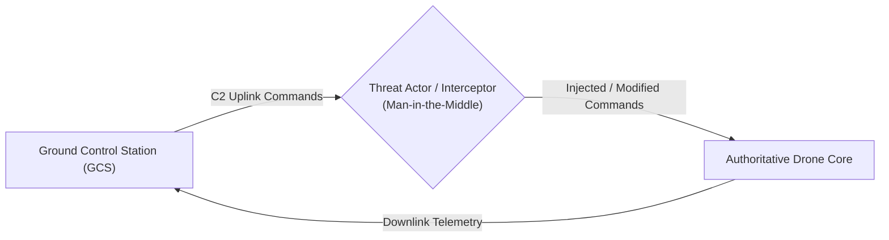
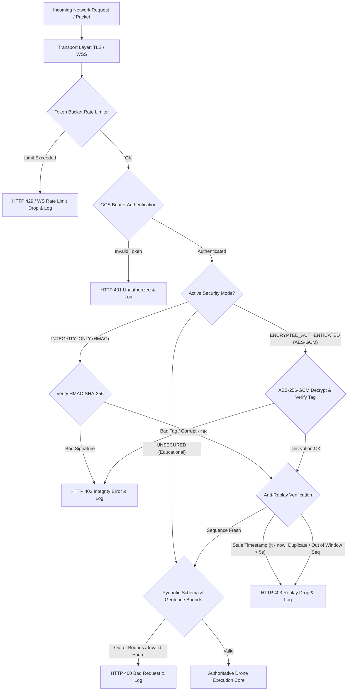

# Security Architecture & Cryptographic Design Specification
## Drone Communication Security Simulation Platform (Phase 0)

---

### Document Information
- **Project:** Drone Communication Security Simulation Platform
- **Phase:** Phase 0 — Requirements and Architecture Blueprint
- **Version:** 1.0.0
- **Status:** APPROVED FOR ARCHITECTURE
- **Classification:** Cryptographic Specifications & Defense Architecture

---

## 1. Threat Model & Attack Surface (STRIDE Analysis)

In unmanned aerial system (UAS) command-and-control (C2) architectures, the link between the Ground Control Station (GCS) and the aerial vehicle is vulnerable to hostile interception, tampering, and denial-of-service. 



### STRIDE Assessment of Drone C2 Link
| Threat Category | UAS Threat Scenario | Severity | Defense Implemented in Platform |
|---|---|---|---|
| **Spoofing Identity** | Adversary transmits commands impersonating legitimate GCS. | CRITICAL | GCS Bearer Token Authentication & Cryptographic Message Authentication Codes. |
| **Tampering with Data** | Adversary flips bits in flight commands (e.g. changing `MOVE_FORWARD` to `DISARM` or altering coordinates). | CRITICAL | AEAD (AES-256-GCM) authentication tag & HMAC-SHA-256 message integrity verification. |
| **Repudiation** | Operator denies issuing an emergency land or crash command. | MEDIUM | Cryptographically verifiable sequence numbers, timestamps, and immutable SQLite audit logs. |
| **Information Disclosure** | Eavesdropper reads mission coordinates, flight path, and telemetry. | HIGH | Application-layer AES-256-GCM payload encryption. |
| **Denial of Service** | Adversary floods the drone C2 receiver with invalid frames, exhausting CPU and buffer resources. | HIGH | Token-bucket rate limiting ($10\text{ req/s}$, burst $20$) and fast-fail schema checks. |
| **Elevation of Privilege** | Unauthenticated user accesses administrative security toggles. | HIGH | Strict role-based authorization headers for control/security endpoints. |

---

## 2. Layered Defense Architecture



---

## 3. Cryptographic Protocols & Design Justification

### 3.1 Separation of Transport Layer vs. Application Layer Security
- **Transport Security (TLS / WSS):** Protects data in transit between the host browser and the local server, mitigating network eavesdropping on shared local subnets.
- **Application Layer Cryptography (AES-GCM / HMAC):** Protects the command payload itself end-to-end, simulating true radio-link protocol wrapping (e.g. MAVLink / STANAG 4586 encrypted frames). Even if a malicious proxy terminates the transport stream, the command cannot be modified without the underlying cryptographic key.

### 3.2 Evaluation Modes: Architectural Justification for HMAC Mode
The platform supports three distinct security operational modes:
1. `UNSECURED`: Demonstrates vulnerability to eavesdropping, bit-flipping, and command replay.
2. `INTEGRITY_ONLY` (HMAC-SHA-256): 
   - *Architectural Rationale:* AES-GCM already provides authenticated encryption; applying HMAC on top of AES-GCM would be computationally redundant and violates cryptographic best practices. However, having a dedicated `INTEGRITY_ONLY` mode provides vital educational contrast: it proves that HMAC protects against unauthorized tampering and spoofing, but **leaves the payload plaintext** (open to eavesdropping and reconnaissance).
3. `ENCRYPTED_AUTHENTICATED` (AES-256-GCM): 
   - State-of-the-art AEAD (Authenticated Encryption with Associated Data). Provides complete confidentiality, ciphertext integrity, and origin authenticity in a single unified operation.

---

## 4. Cryptographic Specifications

### 4.1 AES-256-GCM (Authenticated Encryption with Associated Data)
- **Algorithm:** AES in Galois/Counter Mode (GCM) per NIST SP 800-38D.
- **Key Size:** 256 bits (32 bytes).
- **Initialization Vector (IV / Nonce):** 96 bits (12 bytes). A fresh, cryptographically random nonce generated via `secrets.token_bytes(12)` for every frame. Nonce reuse with the same key is strictly prohibited.
- **Authentication Tag:** 128 bits (16 bytes). Verifies both ciphertext and Additional Authenticated Data (AAD).
- **Associated Data (AAD):** The unencrypted message header is bound directly into the GCM Galois Field multiplication:
  $$\text{AAD} = \text{CanonicalJSON}(\{ \text{message\_id}, \text{sender\_id}, \text{sequence\_number}, \text{timestamp}, \text{security\_mode} \})$$
  *Guarantee:* Any modification to the header metadata causes instantaneous tag validation failure.

### 4.2 HMAC-SHA-256 (Integrity Only Mode)
- **Algorithm:** Hash-based Message Authentication Code using SHA-256 per RFC 2104.
- **Key Size:** 256 bits (32 bytes), derived or separated from encryption keys.
- **Payload Coverage:** Calculated across canonical string representation of header + body:
  $$\text{HMAC} = \text{HMAC}_{\text{key}}(\text{AAD} \parallel \text{Body})$$

### 4.3 Key Management & Secrets Separation
- **Key Generation:** Master keys are generated using CSPRNG (`os.urandom(32)` or Python `secrets`).
- **Key Storage:** Keys are loaded from environment variables (`SIM_AES_KEY`, `SIM_HMAC_KEY`) or from a local secured keyfile (`.secrets/simulation_keys.json`).
- **Zero Exposure Rule:** Plaintext cryptographic keys, seeds, and HMAC secrets are **never sent to the client browser** and are excluded from all API response models.
- **Key Rotation Protocol:** An administrative method (`rotate_keys()`) generates a new key version (`sim_key_v2`), re-initializes the cryptographic state, and registers the change in the audit log.

---

## 5. Anti-Replay Defense Mechanism

To defend against replay attacks where an attacker captures a valid signed or encrypted packet and retransmits it later (e.g. replaying a `MOVE_RIGHT` command until the drone crashes into a wall):

```mermaid
flowchart TD
    Recv[Incoming Message with Sequence N and Timestamp T_msg] --> TimeChk{|T_server - T_msg| <= 5.0s}
    TimeChk -- Stale --> RejTime[Reject: TIMESTAMP_OUT_OF_BOUNDS]
    
    TimeChk -- Fresh --> SeqChk{N > N_max - 64?}
    SeqChk -- Too Old --> RejOld[Reject: SEQUENCE_BEHIND_WINDOW]
    
    SeqChk -- Within Range --> BitChk{Is Bit (N_max - N) already set in Window Bitmask?}
    BitChk -- Yes (Duplicate) --> RejDup[Reject: REPLAY_ATTACK_DETECTED]
    
    BitChk -- No (New) --> AcceptSeq[Mark Bit in Bitmask & Advance N_max if N > N_max]
    AcceptSeq --> Validated[Replay Verification Passed]
```

### 5.1 Dual-Verification Replay Algorithm
1. **Timestamp Freshness Gate:**
   $$|t_{\text{server}} - t_{\text{message}}| \le \Delta t_{\text{tolerance}} \quad (\text{Default: } 5.0\text{ seconds})$$
   Messages outside this window are dropped immediately to bound the memory footprint of replay tracking.
2. **Sliding Window Sequence Bitmask ($W = 64$):**
   - The receiver maintains $N_{\max}$ (the highest valid sequence number observed) and a 64-bit integer bitmask.
   - If $N > N_{\max}$: Bitmask shifts left by $(N - N_{\max})$ positions, least significant bit set to 1, and $N_{\max} \leftarrow N$.
   - If $N \le N_{\max}$ and $N > (N_{\max} - 64)$: If bit at offset $(N_{\max} - N)$ is set, the packet is a **duplicate** (rejected). If unset, the bit is marked 1 (accepted).
   - If $N \le (N_{\max} - 64)$: Packet is older than the window horizon (rejected).

---

## 6. Rate Limiting & DoS Protection

- **Algorithm:** Token Bucket Algorithm per client identifier (`client_id` / client IP).
- **Parameters:**
  - Token replenishment rate: $R = 10\text{ tokens/second}$.
  - Bucket capacity (Burst): $B = 20\text{ tokens}$.
- **Cost:** Each valid command consumes 1 token.
- **Exhaustion Behavior:** Requests arriving when the bucket is empty receive HTTP status `429 Too Many Requests` with header `Retry-After: 1`. An entry is logged in the security incident table.

---

## 7. Security Enforcement Boundaries & Fail-Closed Invariant

### 7.1 Authoritative State Protection Guarantee
Under no circumstances may an unauthorized, tampered, replayed, or malformed message modify the authoritative drone state vector.

$$\forall \text{ message } m \notin \mathcal{V}_{\text{valid}}: \quad \text{State}(t^+) \equiv \text{State}(t^-) \quad \land \quad \text{Version}(t^+) \equiv \text{Version}(t^-)$$

### 7.2 Security Mode `UNSECURED` Safety Clamp
In educational `UNSECURED` mode:
- Cryptographic signature and decryption checks are bypassed.
- **Physical safety limits, Pydantic type safety, and local geofencing remain active.** This ensures that demonstrating an unsecured communication link does not cause memory corruption, unhandled server exceptions, or numerical crashes.
