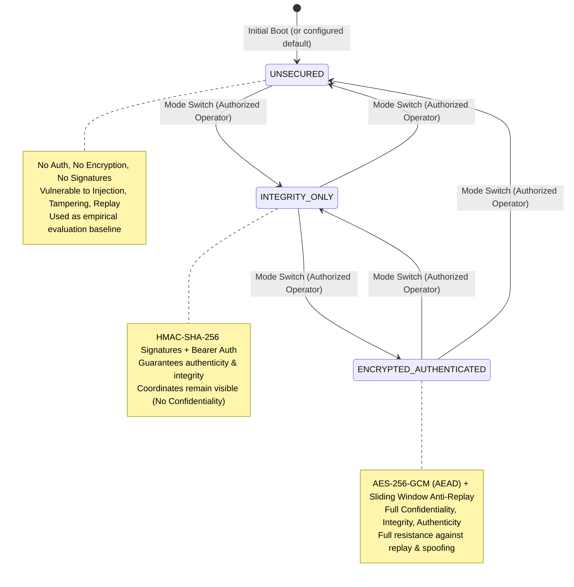

# DroneSec Security Model & Defense Architecture

---

## 1. Threat Model & STRIDE Analysis

In Unmanned Aerial Systems (UAS), the command-and-control (C2) uplink and downlink are exposed to adversarial interception, manipulation, and denial-of-service. DroneSec models the following threat taxonomy:

| Threat Category | UAS Threat Vector | Impact on Legacy/Unsecured Links | DroneSec Defense Implementation | Severity |
|---|---|---|---|---|
| **Spoofing Identity** | Adversary injects flight commands claiming to be legitimate Ground Control Station (`GCS-PRIMARY`). | Unsecured drone accepts counterfeit operator identity and executes hostile flight commands. | Constant-time Bearer token verification (`hmac.compare_digest`) and sender ID claim matching in [`AuthManager`](file:///c:/Users/User/Documents/drone/backend/app/security/authentication.py). | **CRITICAL** |
| **Tampering with Data** | Man-in-the-middle attacker modifies flight coordinates or alters command verb (e.g., changes `MOVE_FORWARD` to `DISARM`). | Drone accepts altered coordinates, potentially causing physical flyaways or crashes. | Authenticated Encryption with Associated Data (**AES-256-GCM**) and **HMAC-SHA-256** signatures; rejects tampered payloads with HTTP 403 `CRYPTO_DECRYPTION_FAILED` / `HMAC_VERIFICATION_FAILED`. | **CRITICAL** |
| **Repudiation** | Rogue operator or compromised ground unit denies dispatching catastrophic commands. | Absence of sequence numbers or persistent audit trail prevents forensic reconstruction. | Canonical cryptographic headers binding monotonically increasing sequence numbers, message UUIDs, and immutable SQLite WAL audit logs. | **MEDIUM** |
| **Information Disclosure** | Passive eavesdropper intercepts downlink telemetry or uplink mission flight paths. | Telemetry coordinates and operational envelopes are exposed in cleartext. | AES-256-GCM symmetric payload encryption in `ENCRYPTED_AUTHENTICATED` mode. Plaintext is never exposed in logs or network packets. | **HIGH** |
| **Denial of Service** | Hostile transmitter floods drone receiver with high-frequency command bursts. | Receiver processing queues saturate, starving legitimate failsafe or emergency land commands. | Token-Bucket Rate Limiter with burst capacity ($20\text{ tokens}$) and steady refill ($10\text{ tokens/s}$), dropping floods with HTTP 429 `RATE_LIMIT_EXCEEDED`. | **HIGH** |
| **Elevation of Privilege** | Adversary switches drone security operating mode or triggers unauthorized cyberattacks. | Security protections disabled remotely. | Operator authorization verification on administrative endpoints (`POST /api/security/mode`, `POST /api/attacks/...`). Production mode strictly rejects default demo tokens. | **HIGH** |

---

## 2. Security Operating Modes

DroneSec provides dynamic, zero-downtime switching across three formal security modes:



---

## 3. Cryptographic Implementation Details

### 3.1 AES-256-GCM Authenticated Encryption with Associated Data (AEAD)
- **Algorithm Standard:** NIST SP 800-38D / RFC 5116.
- **Key Length:** 256 bits ($32\text{ bytes}$), managed securely by [`KeyManager`](file:///c:/Users/User/Documents/drone/backend/app/security/key_manager.py).
- **Nonce Generation:** 96 bits ($12\text{ bytes}$) drawn from the operating system cryptographic pseudo-random number generator (`secrets.token_bytes(12)`).
- **Nonce Bounding & Reuse Prevention:**
  - Nonces are tracked per key ID under a thread lock in [`CryptoService`](file:///c:/Users/User/Documents/drone/backend/app/security/crypto_service.py).
  - Memory consumption is strictly bounded to `MAX_NONCE_TRACKING = 50,000` entries using a FIFO deque. Oldest nonces are evicted once capacity is reached, preventing memory growth during sustained simulation runs.
  - Encryption invocation counters track total encryptions per key to verify safety within NIST SP 800-38D bounds ($< 2^{32}$ invocations per key).
- **Authentication Tag:** 128 bits ($16\text{ bytes}$) computed over both ciphertext and Associated Authenticated Data (AAD).
- **Associated Authenticated Data (AAD):** Canonical representation of the message header (`canonicalize_header`):
  $$\text{AAD} = \text{sender\_id} \,\|\, \text{sequence\_number} \,\|\, \text{timestamp} \,\|\, \text{security\_mode} \,\|\, \text{key\_id}$$
  *Any tampering with header fields invalidates the GCM authentication tag, even if the ciphertext is untouched.*

### 3.2 HMAC-SHA-256 Integrity Verification
- **Standard:** RFC 2104.
- **Key Length:** 256 bits ($32\text{ bytes}$).
- **Signed Data:** Canonical header and canonical payload separated by delimiter:
  $$\text{Data} = \text{canonical}(H) \,\|\, \text{"\|"} \,\|\, \text{canonical}(P)$$
- **Constant-Time Verification:** Signatures are compared using `hmac.compare_digest` to prevent timing side-channel attacks.

### 3.3 Key Management & Rotation
- **Thread Safety:** [`KeyManager`](file:///c:/Users/User/Documents/drone/backend/app/security/key_manager.py) guards key retrieval and key rotation with `threading.Lock`. Concurrent requests never observe partial or corrupt key states.
- **Zero-Downtime Rotation:** New key generations are assigned monotonic key IDs (`k-2026-001`, `k-2026-002`). The receiver accepts valid older keys within a defined grace period before de-registration.
- **Secret Masking:** Real key material is stored in byte arrays and never appears in `__repr__`, string formatting, or logs.

---

## 4. Anti-Replay Protection & Freshness Verification

DroneSec implements a two-phase sliding-window anti-replay mechanism in [`AntiReplayFilter`](file:///c:/Users/User/Documents/drone/backend/app/security/replay_protection.py):

```
       Sliding Window (Size W = 64 frames)
  [ ... 45 46 47 48 49 50 51 52 53 54 ... 64 ]
   <--- Historical Bitmask --->  ^ Highest Sequence Received (H)
```

1. **Timestamp Freshness Filter:**
   Incoming packets must satisfy $|t_{\text{server}} - t_{\text{packet}}| \le 5.0\text{ seconds}$. Packets with timestamps too far in the past or future are rejected with HTTP 403 `TIMESTAMP_OUT_OF_BOUNDS`.
2. **Sequence Number Verification Ticket:**
   - If $s > H$: Verified fresh; eligible to advance the window.
   - If $H - W < s \le H$: Checked against 64-bit window bitmask. If bit $(H - s)$ is already set, packet is rejected with HTTP 403 `REPLAY_ATTACK_DETECTED`.
   - If $s \le H - W$: Dropped as too old.
3. **Two-Phase Commit Protocol:**
   - **Phase 1 (`verify_candidate`):** Checks sequence freshness and returns an isolated `ReplayTicket`. The window bitmask is **NOT** mutated.
   - **Phase 2 (`commit_ticket`):** Called **only after** cryptographic decryption and integrity verification succeed 100%. If cryptographic verification fails, `abort_ticket` is invoked, preventing denial-of-service sequence exhaustion attacks.

---

## 5. Token-Bucket Rate Limiting

The token-bucket rate limiter in [`TokenBucketRateLimiter`](file:///c:/Users/User/Documents/drone/backend/app/security/rate_limiter.py) protects the simulation engine from denial-of-service flooding:

- **Burst Capacity ($B$):** 20 tokens.
- **Refill Rate ($R$):** 10.0 tokens per second.
- **Thread Safety:** Mutex lock protects per-client token accounting.
- **Client Keying:** Buckets are indexed by authenticated `sender_id`, falling back to source IP (`request.client.host`).
- **Memory Bounding:** Inactive client buckets are evicted after 300 seconds of inactivity.

---

## 6. Request Bounding & Production Safety Guards

- **HTTP Request Body Size Cap:** Global middleware and route inspection enforce a strict 64 KiB ($65,536\text{ bytes}$) limit on incoming request bodies, returning HTTP 413 `PAYLOAD_TOO_LARGE` for oversized entities.
- **WebSocket Frame Size Cap:** Incoming WebSocket frames are bounded to 4096 bytes; oversized frames are safely dropped without crashing connection hubs.
- **Production Environment Safety (`SIM_APP_ENV=production`):**
  - Rejects default demonstration Bearer token (`"gcs-sim-token-secret-2026"`).
  - Rejects wildcard CORS origins (`["*"]`).
  - Rejects missing symmetric AES/HMAC keys in secured operating modes.
