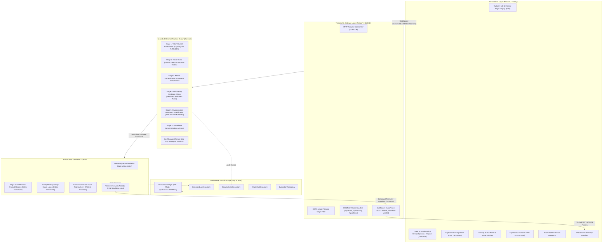
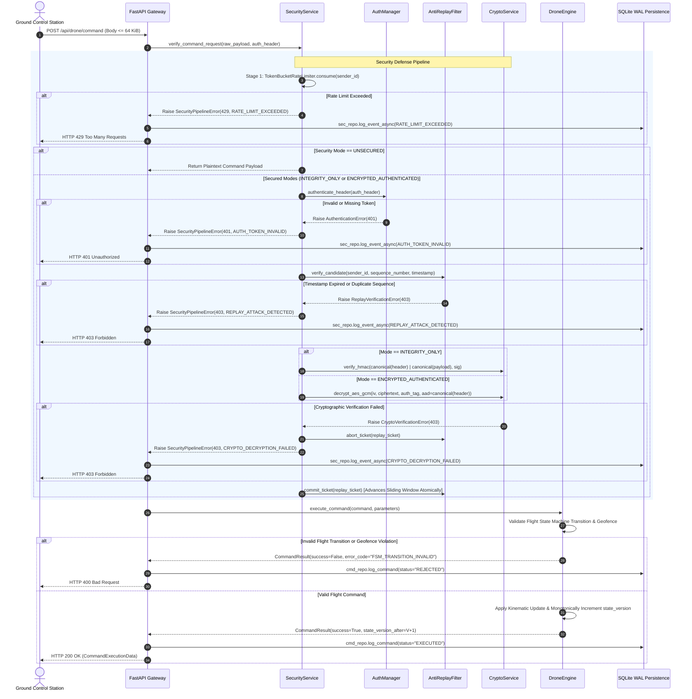

# DroneSec System Architecture Specification

---

## 1. Architectural Philosophy & Invariants

DroneSec is designed as an authoritative, software-in-the-loop (SITL) simulation and security benchmarking platform for Unmanned Aerial Vehicle (UAV) Command and Control (C2). The architecture adheres to five formal invariants:

1. **Authoritative Backend State Single Source of Truth:**
   The backend [`DroneEngine`](file:///c:/Users/User/Documents/drone/backend/app/core/drone_engine.py) maintains the single authoritative simulation state (Cartesian coordinates $(x, y, z)$, velocity vector, battery percentage, flight state, and monotonically increasing `state_version`). The Three.js Ground Control Station (GCS) is strictly an observer and command emitter; it cannot mutate simulation parameters directly.

2. **Decoupled Intercepting Security Pipeline:**
   All incoming commands pass through a six-stage security pipeline ([`SecurityService`](file:///c:/Users/User/Documents/drone/backend/app/security/security_service.py)) before reaching the drone core. The pipeline is fully independent of web presentation logic and fails closed on any cryptographic or protocol error.

3. **Mathematical State Invariance Under Attack:**
   If a command violates security or kinematic rules, authoritative state remains mathematically unchanged:
   $$\Delta \mathbf{p} = \|\mathbf{p}_{\text{final}} - \mathbf{p}_{\text{initial}}\| = 0 \quad \land \quad \text{state\_version}_{\text{final}} = \text{state\_version}_{\text{initial}}$$

4. **Zero Reader-Writer Contention via SQLite WAL Mode:**
   All persistent audit records (commands, security alerts, cyberattack runs, and statistical evaluation batches) are stored in SQLite with Write-Ahead Logging (`PRAGMA journal_mode=WAL;`), enabling simultaneous high-frequency readers and writers without database locking.

5. **Local Loopback Isolation:**
   All network communication is strictly confined to local loopback (`127.0.0.1` / `localhost`). Zero external or cloud infrastructure is required or accessed.

---

## 2. High-Level System Architecture

---

## 3. End-to-End Command Execution Lifecycle

The diagram below traces an incoming command from submission to authoritative execution or fail-closed rejection:

---

## 4. Component Directory & File Mapping

| Module / Component | Source File | Responsibilities |
|---|---|---|
| **FastAPI Core & Lifecycle** | [`backend/app/main.py`](file:///c:/Users/User/Documents/drone/backend/app/main.py) | Application lifespan, router mounting, 64 KiB request limit middleware, static file serving. |
| **Configuration Engine** | [`backend/app/config.py`](file:///c:/Users/User/Documents/drone/backend/app/config.py) | Environment loading, production safety guards (`__post_init__`), CORS origin whitelisting. |
| **REST & WebSocket Routes** | [`backend/app/api/routes.py`](file:///c:/Users/User/Documents/drone/backend/app/api/routes.py) | Route dispatch, schema validation, operator authorization dependency. |
| **Authoritative Drone Engine** | [`backend/app/core/drone_engine.py`](file:///c:/Users/User/Documents/drone/backend/app/core/drone_engine.py) | Thread-safe kinematic integration, geofence boundary enforcement, state versioning. |
| **Flight State Machine (FSM)** | [`backend/app/core/flight_fsm.py`](file:///c:/Users/User/Documents/drone/backend/app/core/flight_fsm.py) | Formal flight state enumeration (`DISARMED` to `EMERGENCY_LANDING`) and transition safety. |
| **Geodesic Coordinates** | [`backend/app/core/coordinate_service.py`](file:///c:/Users/User/Documents/drone/backend/app/core/coordinate_service.py) | WGS-84 geodesic reference conversion to Cartesian meters. |
| **Cryptographic Service** | [`backend/app/security/crypto_service.py`](file:///c:/Users/User/Documents/drone/backend/app/security/crypto_service.py) | AES-256-GCM AEAD encryption/decryption, HMAC-SHA-256, bounded nonce deque. |
| **Key Management** | [`backend/app/security/key_manager.py`](file:///c:/Users/User/Documents/drone/backend/app/security/key_manager.py) | Thread-safe symmetric key storage, random generation, and zero-downtime rotation. |
| **Anti-Replay Filter** | [`backend/app/security/replay_protection.py`](file:///c:/Users/User/Documents/drone/backend/app/security/replay_protection.py) | 64-bit sliding window, 5-second timestamp freshness, two-phase commit tickets. |
| **Token-Bucket Rate Limiter** | [`backend/app/security/rate_limiter.py`](file:///c:/Users/User/Documents/drone/backend/app/security/rate_limiter.py) | Per-sender and per-IP burst limiting with continuous token replenishment. |
| **Security Service Orchestrator** | [`backend/app/security/security_service.py`](file:///c:/Users/User/Documents/drone/backend/app/security/security_service.py) | Coordinates pipeline verification stages 1–6 and audit event generation. |
| **Cyberattack Orchestrator** | [`backend/app/services/attack_service.py`](file:///c:/Users/User/Documents/drone/backend/app/services/attack_service.py) | Manages attack runs ATK-01 to ATK-06, mutual exclusion locking, and cancellation. |
| **Scenario Runner** | [`backend/app/attacks/scenario_runner.py`](file:///c:/Users/User/Documents/drone/backend/app/attacks/scenario_runner.py) | Executes attack payloads against internal client, verifies state invariants. |
| **Payload Factory** | [`backend/app/attacks/payload_factory.py`](file:///c:/Users/User/Documents/drone/backend/app/attacks/payload_factory.py) | Constructs bit-flipped, replayed, forged, and flooded test payloads. |
| **Evaluation Framework** | [`backend/app/evaluation/runner.py`](file:///c:/Users/User/Documents/drone/backend/app/evaluation/runner.py) | Automated 21-experiment evaluation suite across all 3 modes. |
| **Telemetry Service** | [`backend/app/services/telemetry_service.py`](file:///c:/Users/User/Documents/drone/backend/app/services/telemetry_service.py) | Fixed-interval ($20\text{ Hz}$) simulation tick loop and broadcast coordinator. |
| **WebSocket Hub** | [`backend/app/websocket/hub.py`](file:///c:/Users/User/Documents/drone/backend/app/websocket/hub.py) | Client connection registry, ping/pong heartbeats, 4096-byte frame dropping. |
| **SQLite WAL Persistence** | [`backend/app/persistence/database.py`](file:///c:/Users/User/Documents/drone/backend/app/persistence/database.py) | Connection management, WAL mode initialization, schema migrations. |
| **Repositories** | [`backend/app/persistence/repositories.py`](file:///c:/Users/User/Documents/drone/backend/app/persistence/repositories.py) | Asynchronous thread-safe repositories for command logs, security events, attack runs. |
