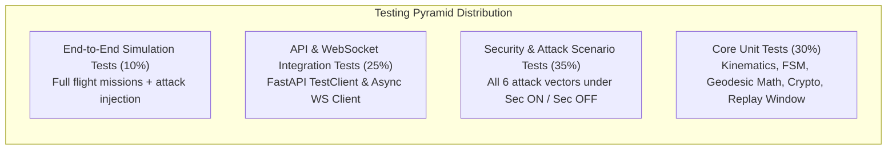
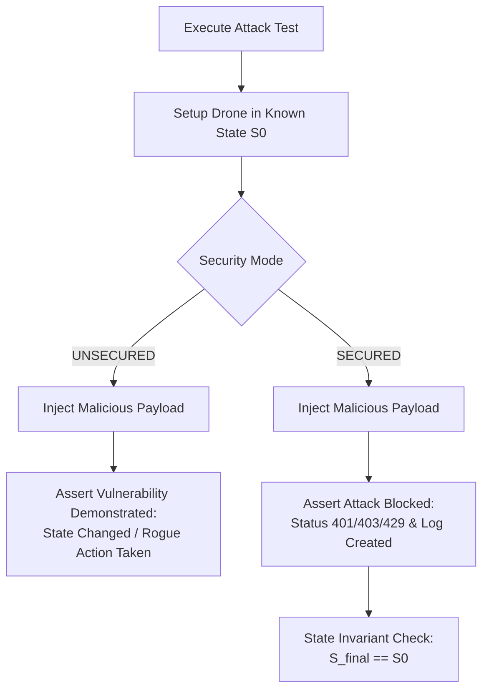

# Testing Strategy & Quality Assurance Framework
## Drone Communication Security Simulation Platform (Phase 0)

---

### Document Information
- **Project:** Drone Communication Security Simulation Platform
- **Phase:** Phase 0 — Requirements and Architecture Blueprint
- **Version:** 1.0.0
- **Status:** APPROVED FOR ARCHITECTURE
- **Classification:** Verification, Validation & Automated Testing Strategy

---

## 1. Testing Philosophy & Test Pyramid

The platform follows a rigorous multi-tier testing strategy. Because this is a security demonstration platform, **negative security testing and state invariant verification** receive equal priority to functional happy-path testing.



---

## 2. Test Suite Classification

### 2.1 Tier 1: Core Unit Tests
Focuses on pure mathematical logic, state transitions, and cryptographic algorithms in total isolation from network I/O or web frameworks.

| Test Suite File | Subsystem Under Test | Primary Test Cases |
|---|---|---|
| `test_drone_engine.py` | Virtual Drone Core | • Valid state transitions (`ARM` $\to$ `TAKEOFF` $\to$ `HOVERING` $\to$ `MOVE` $\to$ `LAND`).<br>• Invalid transitions (e.g. `TAKEOFF` while `DISARMED`).<br>• Kinematic step calculations and heading normalization.<br>• Low-battery failsafe triggers ($15\%$ limit, $5\%$ emergency descent).<br>• Geofence boundary clamping. |
| `test_coordinates.py` | Geodesic Conversion | • Forward conversion $(x, y, z) \to (\text{lat}, \text{lon}, \text{alt})$.<br>• Inverse conversion $(\text{lat}, \text{lon}, \text{alt}) \to (x, y, z)$.<br>• Numerical round-trip consistency ($|\text{error}| < 10^{-6}\text{ m}$).<br>• Pole/meridian singularity checks. |
| `test_security_crypto.py`| Cryptographic Engine | • AES-256-GCM encryption and decryption round-trip.<br>• Authentication tag verification and tampered tag detection.<br>• AAD binding: header mutation invalidates tag.<br>• HMAC-SHA-256 signature verification and bit-flip rejection.<br>• Nonce generation freshness and non-reuse. |
| `test_anti_replay.py` | Replay Filter | • Monotonic sequence advancement.<br>• In-window duplicate sequence number rejection ($W = 64$).<br>• Out-of-window stale sequence rejection.<br>• Timestamp tolerance window enforcement ($|t - \text{now}| > 5.0\text{s}$). |
| `test_rate_limiter.py` | Token Bucket Limiter | • Continuous replenishment rate verification.<br>• Burst capacity limit enforcement.<br>• Multi-client bucket isolation. |

---

### 2.2 Tier 2: API & WebSocket Integration Tests
Tests HTTP routing, request parsing, response formatting, status codes, and WebSocket subscription streams using `fastapi.testclient.TestClient` and `pytest-asyncio`.

| Test Suite File | Subsystem Under Test | Primary Test Cases |
|---|---|---|
| `test_api_routes.py` | REST API Gateway | • `GET /health` operational checks.<br>• `GET /api/drone/state` schema validation.<br>• `POST /api/drone/command` in `UNSECURED` mode.<br>• `POST /api/drone/command` in `ENCRYPTED_AUTHENTICATED` mode.<br>• Rate-limit rejection returning HTTP `429`.<br>• Schema parsing errors returning HTTP `422`. |
| `test_websockets.py` | WebSocket Hub | • Client handshake and query token verification.<br>• Telemetry frame streaming cadence ($10\text{ Hz}$).<br>• Push delivery of `SECURITY_ALERT` frames.<br>• Client disconnect and reconnect handling. |

---

### 2.3 Tier 3: Attack Scenario & Negative Security Tests
Executes the six formalized attack scenarios against the running simulator to verify baseline vulnerability and defensive efficacy.



---

### 2.4 Tier 4: State Invariant Verification Tests
The most critical safety guarantee in the platform: **a rejected or replayed command must never alter authoritative drone state.**

```python
# Conceptual Invariant Test Pattern
def test_invariant_rejected_command_zero_state_mutation(client, drone_engine):
    # 1. Capture baseline authoritative state
    initial_snapshot = drone_engine.get_state_snapshot()
    initial_version = initial_snapshot.state_version
    initial_coords = (initial_snapshot.x, initial_snapshot.y, initial_snapshot.z)
    
    # 2. Submit tampered / unauthorized payload
    response = client.post("/api/drone/command", json=corrupted_payload)
    assert response.status_code in [400, 401, 403, 429]
    
    # 3. Assert Authoritative State Invariants
    post_snapshot = drone_engine.get_state_snapshot()
    assert post_snapshot.state_version == initial_version, "State version incremented on rejected command!"
    assert (post_snapshot.x, post_snapshot.y, post_snapshot.z) == initial_coords, "Coordinates drifted on rejected command!"
    assert post_snapshot.flight_state == initial_snapshot.flight_state, "Flight state mutated on rejected command!"
```

---

### 2.5 Tier 5: Performance & Benchmarking Tests
Executed locally to ensure simulation loop stability on baseline student laptop hardware:
1. **Kinematic Loop Drift:** Assert simulation tick jitter is $< \pm 2.0\text{ ms}$ over 1000 iterations at $20\text{ Hz}$.
2. **Cryptographic Overhead:** Measure latency delta between unsecured command processing and AES-256-GCM authenticated processing (target: overhead $< 2.5\text{ ms}$).
3. **Memory Footprint:** Assert backend memory consumption remains stable ($< 250\text{ MB}$) during 10,000 continuous command evaluations.

---

## 3. Subsystem Acceptance Criteria Matrix

| Subsystem | Requirement ID | Acceptance Verification Method | Pass Criteria |
|---|---|---|---|
| **Drone Core** | FR-A.1 to FR-A.6 | `test_drone_engine.py` | 100% of state transitions match state diagram; zero unhandled exceptions. |
| **Coordinates** | FR-B.1 to FR-B.4 | `test_coordinates.py` | Geodesic round-trip error $< 1.0\times 10^{-6}\text{ m}$. |
| **Security Pipeline** | FR-D.1 to FR-D.5 | `test_security_crypto.py`, `test_anti_replay.py` | Corrupted tags and replayed sequences rejected 100% of the time. |
| **Attack Harness** | FR-E.1 to FR-E.2 | `test_attack_scenarios.py` | All 6 scenarios pass; invariants hold under security defense. |
| **API & Hub** | FR-C.1 to FR-C.2 | `test_api_routes.py`, `test_websockets.py` | All endpoints return conforming schemas; WS streams at $10\text{ Hz} \pm 1\text{ Hz}$. |
| **Persistence** | FR-G.1 to FR-G.2 | `test_analytics.py` | All security events logged to SQLite; formulas compute valid metrics without division-by-zero errors. |

---

## 4. Test Execution & CI Automation Commands

```bash
# Run all unit tests
pytest backend/tests/test_drone_engine.py backend/tests/test_coordinates.py backend/tests/test_security_crypto.py -v

# Run full integration and security negative test suite
pytest backend/tests/ -v --cov=app --cov-report=term-missing

# Run attack scenario tests specifically
pytest backend/tests/test_attack_scenarios.py -v -s

# Run state invariant verification suite
pytest backend/tests/test_state_invariants.py -v
```
